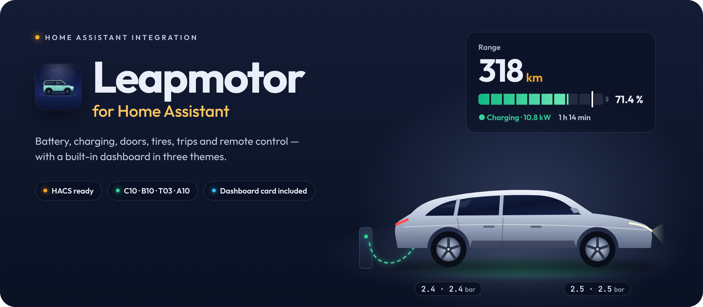
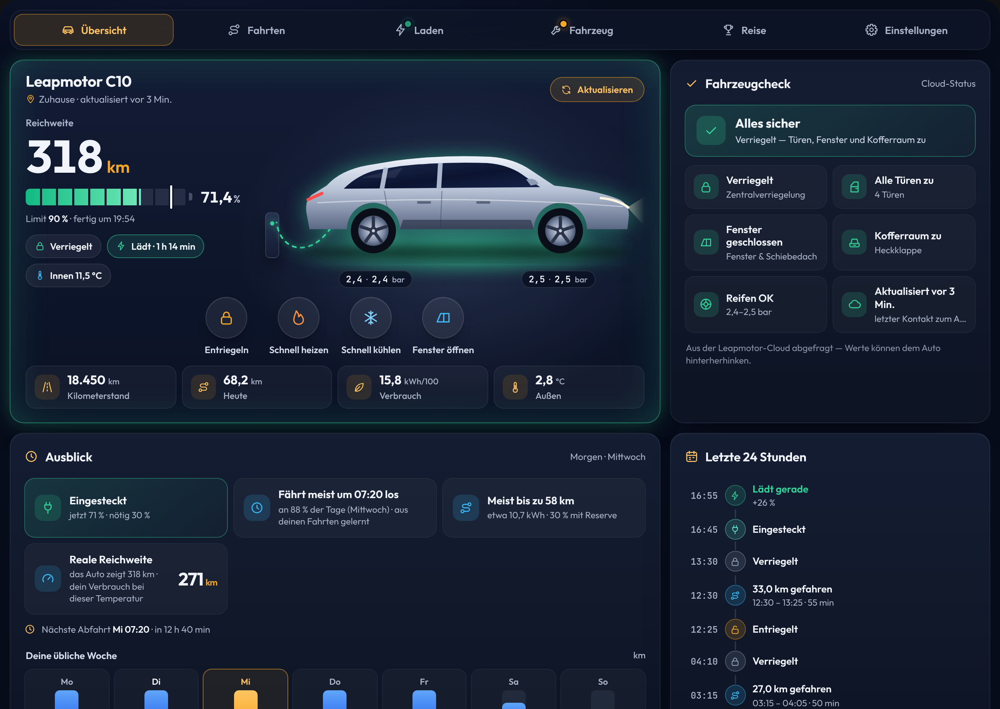
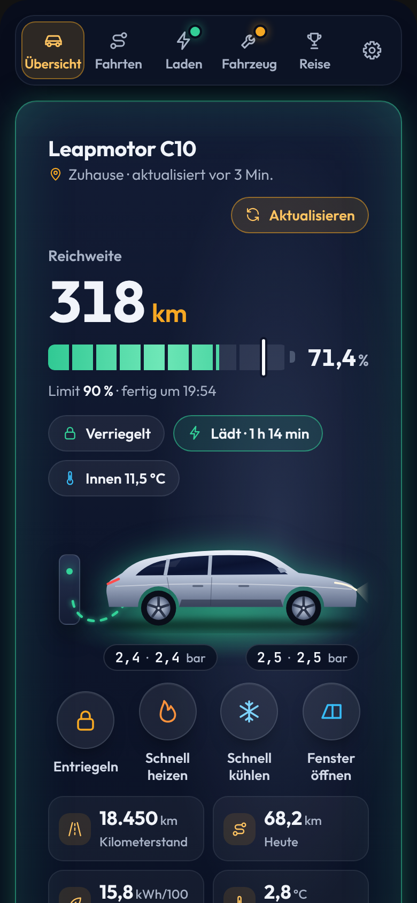
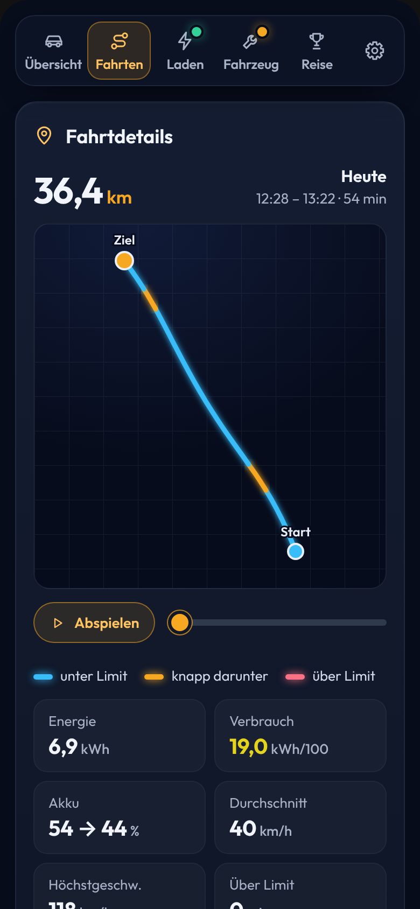
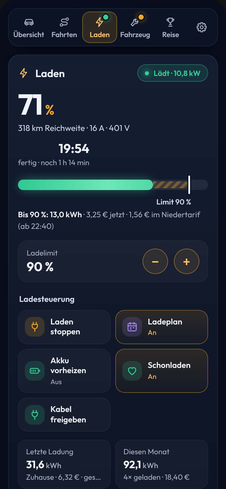
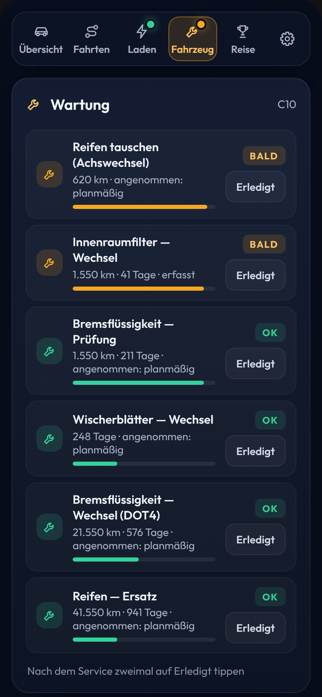
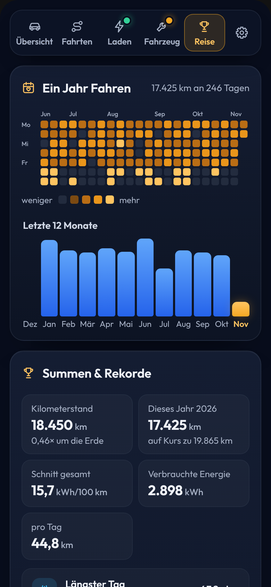
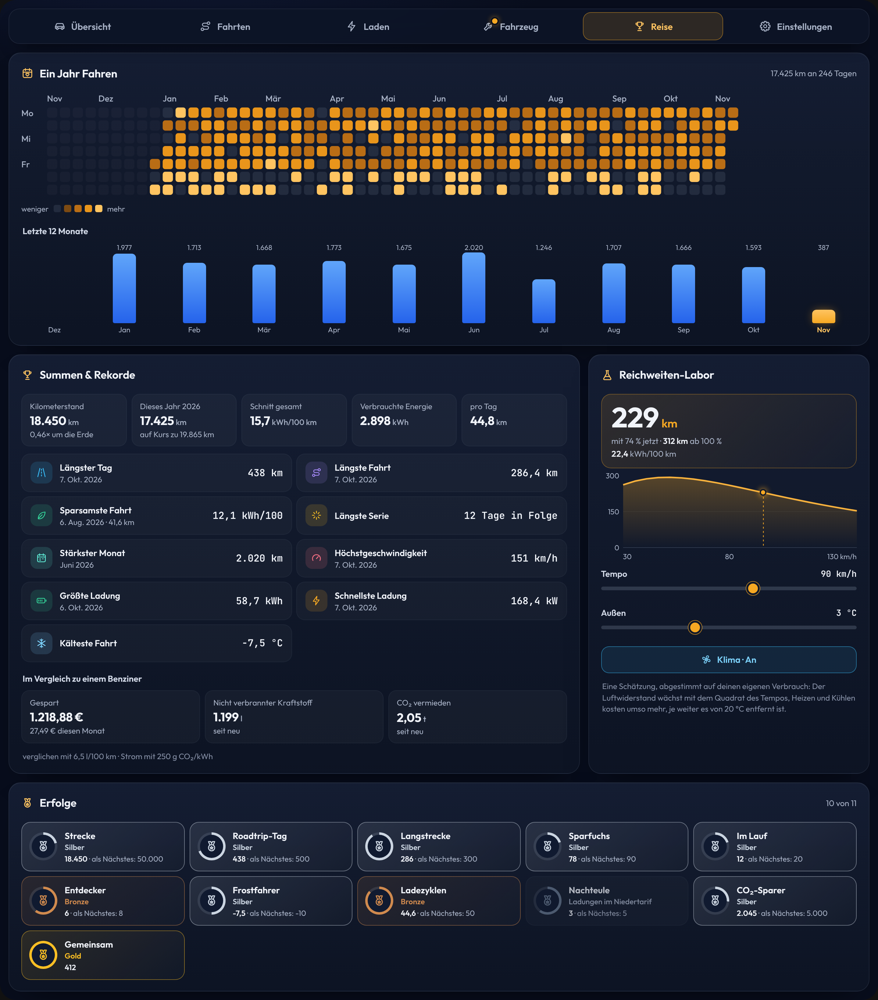
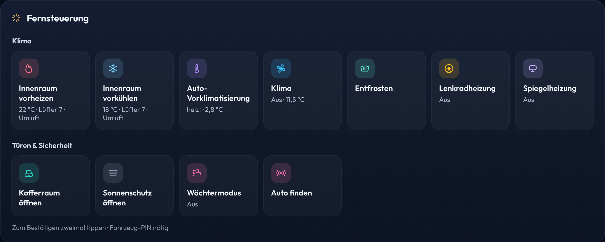

<p align="center">
  
</p>

<p align="center">
  <a href="https://hacs.xyz/"></a>
  
  
  <a href="LICENSE"></a>
</p>

<p align="center">
  <b>Dein Leapmotor in Home Assistant.</b><br>
  Fahrzeug, Akku, Laden, Fahrten und Kosten im Überblick, dazu die Fernsteuerung.
</p>

<p align="center"><a href="README.md">English</a> · <a href="README.sl.md">Slovenščina</a> · <b>Deutsch</b></p>

<br>

## Was die Integration kann

- **Fahrzeugstatus:** Akku, Reichweite, Verriegelung, Türen, Fenster, Reifen und Standort.
- **Heizen und Kühlen:** schnelles Heizen auf 22 °C oder Kühlen auf 18 °C. Der Innenraum lässt sich auch automatisch je nach Außentemperatur vorbereiten.
- **Laden und Kosten:** Ladelimit einstellen (auch beim T03), dazu jeder Ladevorgang mit seinen Kosten zu Hause und an öffentlichen AC- und DC-Ladern. Ein Niedertarif (Nachtstrom) wird ebenfalls unterstützt.
- **Fahrtenbuch:** Strecke, Verbrauch und Kosten jeder Fahrt.
- **Fahrtenkarte:** die Route jeder Fahrt, nach Geschwindigkeit eingefärbt.
- **Tempowarnung:** eine Warnung, wenn du schneller fährst als deine eingestellte Geschwindigkeit oder das im Auto gesetzte Limit.
- **Fahrzeugbild:** zeigt den Zustand von Türen, Kofferraum, Fenstern, Klima, Laden und Fahren.
- **Wartung:** Serviceplan für T03, B10, C10 und C10 REEV.
- **Zusätzliche Daten:** Akkugesundheit, Akkuverlust im Stand und eine Warnung, wenn ein Reifen langsam Druck verliert.
- **Lernt deine Gewohnheiten:** Aus deinen eigenen Fahrten erkennt die Integration, wann das Auto an welchem Wochentag üblicherweise losfährt und wie weit. Sie sagt dir, ob der Akku für morgen reicht, und kann das Auto vor der Abfahrt vorwärmen, ganz ohne Zeitplan.
- **Reale Reichweite:** die Reichweite aus deinem eigenen Verbrauch bei der aktuellen Außentemperatur, neben dem Wert des Autos.
- **Reise:** ein Jahr Fahrten im Kalender, deine Rekorde, eine Eco-Wertung für jede Fahrt, Erfolge sowie das gesparte Geld, der gesparte Kraftstoff und das vermiedene CO₂ im Vergleich zu einem Benziner.
- **Fahrten abspielen und exportieren:** eine Fahrt auf der Karte abspielen und das Fahrtenbuch als CSV exportieren.
- **Ladekurve und Ladeverlauf:** Ladeleistung über dem Akkustand, eine Warnung, wenn das Auto langsamer lädt als üblich, und der Ladeverlauf aus der Cloud mit Ort und Kosten.
- **Fahrzeugsoftware und Nachrichten:** ein Hinweis, wenn Leapmotor eine neue Softwareversion anbietet, mit den Versionshinweisen, sowie die Nachrichten aus der Leapmotor-App.
- **Fernsteuerung:** Verriegeln, Kofferraum, Fenster, Wächtermodus, Laden und mehr.
- **Automatisierungen:** fertige Automatisierungen, die du in Home Assistant importieren kannst.
- **Sprache:** Das Dashboard ist vollständig auf Deutsch. Einige Namen von Entitäten und Einstellungen erscheinen in Home Assistant noch auf Englisch; vollständig übersetzt sind Englisch und Slowenisch.

<p align="center">
  
</p>

<br>

## Installation

### Was du brauchst

- Home Assistant 2025.3 oder neuer und [HACS](https://hacs.xyz/).
- E-Mail und Passwort deines Leapmotor-Kontos. Ich empfehle ein zweites Konto, mit dem das Auto geteilt ist, damit dich die offizielle App nicht abmeldet.
- Die Zertifikate der App: `app_cert.pem` und `app_key.pem`. Sie sind nicht im Repository enthalten; du musst sie dir selbst besorgen.
- Die Fahrzeug-PIN ist standardmäßig `0000`. Wenn du sie im Auto geändert hast, ändere sie auch hier.

### Installation mit HACS

[](https://my.home-assistant.io/redirect/hacs_repository/?owner=Sabotin&repository=LeapBridge&category=integration)

1. Öffne in HACS **⋮ → Benutzerdefinierte Repositories** (*Custom repositories*).
2. Füge `https://github.com/Sabotin/LeapBridge` hinzu und wähle den Typ **Integration**.
3. Suche nach **Leapmotor**, klicke auf **Herunterladen** und starte Home Assistant neu.
4. Öffne **Einstellungen → Geräte & Dienste → Integration hinzufügen → Leapmotor**.
5. Lade beide Zertifikate hoch und gib deine Kontodaten ein. Nach der Einrichtung erscheint Leapmotor in der Seitenleiste.

**Aktualisieren:** HACS installiert die neueste Version aus dem Branch `main`. Um nach einer neuen Version zu suchen, öffne Leapmotor in HACS und wähle **⋮ → Informationen aktualisieren** (*Update information*), dann **Erneut herunterladen** (*Redownload*) und starte Home Assistant neu. Wenn die Karte noch alt aussieht, lade den Browser mit **Strg + F5** neu.

Manuelle Installation und ausführliche Anleitung: **[Anleitung auf Englisch](docs/guide-en.md)**.

<br>

## Dashboard

Nach der Installation erscheint **Leapmotor** von selbst in der Seitenleiste. Das Dashboard ist fertig eingerichtet, du musst nichts weiter einstellen.

Wenn du mehrere Autos hast, bekommt jedes sein eigenes Dashboard.

Wenn du es nicht in der Seitenleiste haben möchtest, kannst du es unter **Leapmotor → Konfigurieren** ausblenden (Schalter *Show the Leapmotor dashboard in the sidebar*).

Das Dashboard hat fünf Tabs und zusätzlich den Tab **Einstellungen**. Ein Punkt an einem Tab bedeutet, dass es auf dieser Seite etwas zu sehen gibt. Die Bilder unten zeigen das Design Auto-App.

<table>
  <tr>
    <td width="20%" valign="top"></td>
    <td width="20%" valign="top"></td>
    <td width="20%" valign="top"></td>
    <td width="20%" valign="top"></td>
    <td width="20%" valign="top"></td>
  </tr>
  <tr>
    <td valign="top"><b>Übersicht</b><br><sub>Akkustand, Schnelltasten zum Entriegeln, Heizen, Kühlen und Fensteröffnen, der Ausblick auf den nächsten Tag, ein Fahrzeug-Check und was in den letzten 24 Stunden passiert ist.</sub></td>
    <td valign="top"><b>Fahrten</b><br><sub>Jede Fahrt mit Karte, Wiedergabe, Geschwindigkeit, Verbrauch, Akku, Kosten und Eco-Wertung. Dazu das Fahrtenbuch nach Tagen mit CSV-Export, die letzten 7 Tage und deine häufigen Strecken.</sub></td>
    <td valign="top"><b>Laden</b><br><sub>Ladeübersicht, das Ladelimit, die letzten 24 Stunden, Akkugesundheit, die Ladekurve und der Ladeverlauf.</sub></td>
    <td valign="top"><b>Fahrzeug</b><br><sub>Wartung, Reifen, zusätzliche Daten zu Kosten, Akkuverlust im Stand und Verbrauch nach Temperatur, die Fahrzeugsoftware und Nachrichten.</sub></td>
    <td valign="top"><b>Reise</b><br><sub>Ein Jahr Fahrten im Kalender, Summen und Rekorde, der Vergleich mit einem Benziner, ein Reichweiten-Labor und Erfolge.</sub></td>
  </tr>
</table>

<p align="center">
  
</p>

Du kannst die Karte auch zu einem Dashboard hinzufügen, das du schon hast:

**Karte hinzufügen → Leapmotor**

Oder von Hand:

```yaml
type: custom:leapmotor-card
```

Es gibt drei Designs: Klassisch (Tag- oder Nachthimmel), Fahrerdisplay (Instrumente rund ums Auto) und Auto-App.

Im Tab **Einstellungen** kann jeder Benutzer das Design, die Tag- oder Nachtansicht und die Sprache wählen. Die Einstellungen gelten für diesen Benutzer auf jedem Gerät.

Während das Auto lädt, steht eine Wallbox daneben.

Wenn die Karte nach der Installation nicht gefunden wird, lade den Browser einmal mit **Strg + F5** neu.

<br>

## Heizen, Kühlen und Fernsteuerung

<p align="center">
  
</p>

Den Innenraum kannst du auf drei Arten vorbereiten:

- **Innenraum vorheizen:** 22 °C, Lüfter 7, nur Umluft.
- **Innenraum vorkühlen:** Klimaanlage, 18 °C, Lüfter 7.
- **Auto-Vorklimatisierung:** kühlt, wenn es draußen wärmer als 20 °C ist, sonst wird geheizt.

Alle diese Werte kannst du beim Fahrzeug unter **Geräte & Dienste → Leapmotor → Fahrzeug → Konfigurieren** ändern.

Befehle, die die Sicherheit des Autos betreffen, müssen mit einem doppelten Tippen bestätigt werden.

Tippe nach einem Service unter **Wartung** zweimal auf **Erledigt**, damit das Serviceintervall neu beginnt.

<br>

## Einstellungen

Einige Einstellungen gehören zum Konto, andere zum einzelnen Fahrzeug.

| Was | Wo |
| --- | --- |
| Ladepreis zu Hause, öffentlich AC und DC, Niedertarif | **Leapmotor → Konfigurieren** (das Zahnrad beim Konto) |
| Kraftstoffpreis und Verbrauch eines vergleichbaren Benziners, CO₂ deines Stroms (für die Ersparnis) | **Leapmotor → Konfigurieren** |
| PIN, Vorheizen, Vorkühlen, Akkukapazität, Tempowarnung | Beim **Fahrzeug** unter dem Konto → **Konfigurieren** |
| Wie oft während der Fahrt aufgezeichnet wird (für die Karte) | **Leapmotor → Konfigurieren**, standardmäßig 1 Minute |
| Leapmotor in der Seitenleiste anzeigen | **Leapmotor → Konfigurieren** |
| Sprache | Klicke unten links auf deinen Namen → **Sprache** |

<br>

## Automatisierungen

Für einige häufige Aufgaben gibt es fertige Automatisierungen. Importiere sie direkt in Home Assistant und passe sie bei Bedarf an.

| Automatisierung | |
| --- | --- |
| **Vorklimatisieren vor deiner üblichen Abfahrt** (die Uhrzeit wird aus deinen Fahrten gelernt) | [](https://my.home-assistant.io/redirect/blueprint_import/?blueprint_url=https%3A%2F%2Fgithub.com%2FSabotin%2FLeapBridge%2Fblob%2Fmain%2Fblueprints%2Fautomation%2Fleapmotor%2Fsmart_precondition.yaml) |
| **Für morgen anstecken** (nur wenn der Akku für den nächsten Tag nicht reicht) | [](https://my.home-assistant.io/redirect/blueprint_import/?blueprint_url=https%3A%2F%2Fgithub.com%2FSabotin%2FLeapBridge%2Fblob%2Fmain%2Fblueprints%2Fautomation%2Fleapmotor%2Fsmart_charge_reminder.yaml) |
| **Benachrichtigung, wenn mit dem Auto etwas passiert** (Fahrt, Laden, Kabel, Nachricht, Update) | [](https://my.home-assistant.io/redirect/blueprint_import/?blueprint_url=https%3A%2F%2Fgithub.com%2FSabotin%2FLeapBridge%2Fblob%2Fmain%2Fblueprints%2Fautomation%2Fleapmotor%2Fcar_event_notification.yaml) |
| **Warnung bei langsamem Laden** | [](https://my.home-assistant.io/redirect/blueprint_import/?blueprint_url=https%3A%2F%2Fgithub.com%2FSabotin%2FLeapBridge%2Fblob%2Fmain%2Fblueprints%2Fautomation%2Fleapmotor%2Fslow_charging_alert.yaml) |
| **Vorklimatisieren vor der Abfahrt** (Uhrzeit und Tage wählen) | [](https://my.home-assistant.io/redirect/blueprint_import/?blueprint_url=https%3A%2F%2Fgithub.com%2FSabotin%2FLeapBridge%2Fblob%2Fmain%2Fblueprints%2Fautomation%2Fleapmotor%2Fprecondition_before_departure.yaml) |
| **Benachrichtigung, wenn das Laden fertig ist** | [](https://my.home-assistant.io/redirect/blueprint_import/?blueprint_url=https%3A%2F%2Fgithub.com%2FSabotin%2FLeapBridge%2Fblob%2Fmain%2Fblueprints%2Fautomation%2Fleapmotor%2Fcharging_complete.yaml) |
| **Warnung, wenn das Auto unverschlossen bleibt** (oder automatisch verriegeln) | [](https://my.home-assistant.io/redirect/blueprint_import/?blueprint_url=https%3A%2F%2Fgithub.com%2FSabotin%2FLeapBridge%2Fblob%2Fmain%2Fblueprints%2Fautomation%2Fleapmotor%2Fleft_unlocked.yaml) |
| **Erinnerung ans Anstecken** (abends, wenn der Akku niedrig ist) | [](https://my.home-assistant.io/redirect/blueprint_import/?blueprint_url=https%3A%2F%2Fgithub.com%2FSabotin%2FLeapBridge%2Fblob%2Fmain%2Fblueprints%2Fautomation%2Fleapmotor%2Fplug_in_reminder.yaml) |
| **Warnungen** (Türen, Fenster, Reifen, Service) | [](https://my.home-assistant.io/redirect/blueprint_import/?blueprint_url=https%3A%2F%2Fgithub.com%2FSabotin%2FLeapBridge%2Fblob%2Fmain%2Fblueprints%2Fautomation%2Fleapmotor%2Fattention_alert.yaml) |
| **Tempowarnung** (Geschwindigkeit und Limit aufs Handy) | [](https://my.home-assistant.io/redirect/blueprint_import/?blueprint_url=https%3A%2F%2Fgithub.com%2FSabotin%2FLeapBridge%2Fblob%2Fmain%2Fblueprints%2Fautomation%2Fleapmotor%2Fspeed_alert.yaml) |

<br>

## Wenn etwas nicht funktioniert

| Problem | Was du versuchen kannst |
| --- | --- |
| Zertifikatsfehler | Die Meldung sagt dir, welche Datei falsch ist. Prüfe, ob du ein zusammengehöriges Zertifikatspaar verwendest. |
| Falsches Passwort (`code 21`) | Wenn die Anmeldung in der App funktioniert: abmelden, das Passwort einmal in der App ändern und erneut versuchen. |
| Die App meldet dich immer wieder ab | Versuche ein zweites Konto, mit dem das Auto von deinem Hauptkonto aus geteilt ist. |
| Ein Befehl funktioniert nicht | Prüfe die Fahrzeug-PIN und die Berechtigungen des geteilten Kontos. |
| *Token is invalid* | Die Integration versucht von selbst, sich neu anzumelden. Wenn der Fehler immer wieder kommt, nutze ein zweites Konto, mit dem das Auto geteilt ist. |
| Die Daten sind veraltet | Tippe auf der Karte auf **Aktualisieren**. Die Daten kommen aus der Cloud, deshalb kann es eine kurze Verzögerung geben. |

<br>

## Dank

- Die Integration basiert auf **[leapmotor-ha](https://github.com/kerniger/leapmotor-ha)** von [kerniger](https://github.com/kerniger) (MIT).
- Fahrtenbuch, Ladekosten, Wartung und zusätzliche Befehle sind aus **[LeapConnect](https://github.com/markoceri/leapconnect)** von [Marco Mancino](https://github.com/markoceri) (AGPL-3.0) übernommen.

**Lizenz:** GNU AGPL-3.0. Siehe [LICENSE](LICENSE) und [NOTICE.md](NOTICE.md).

Inoffizielles Projekt, nicht mit Leapmotor verbunden. Die Nutzung erfolgt auf eigene Gefahr.

<p align="center"><br><br><sub>Gemacht für Leapmotor-Fahrer</sub></p>
