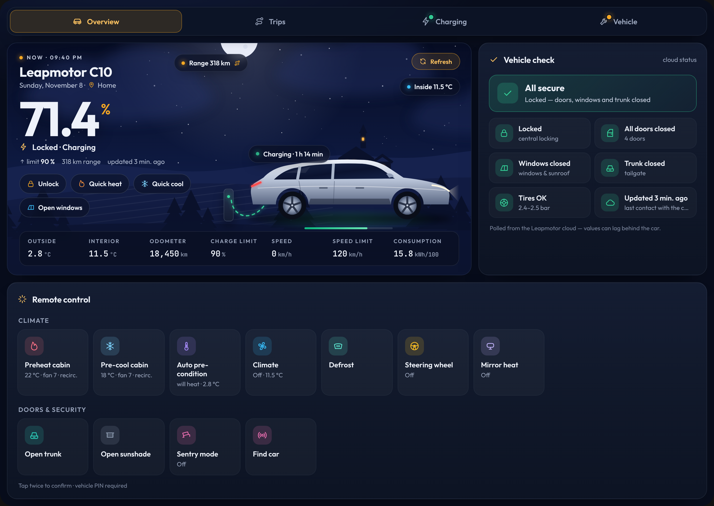
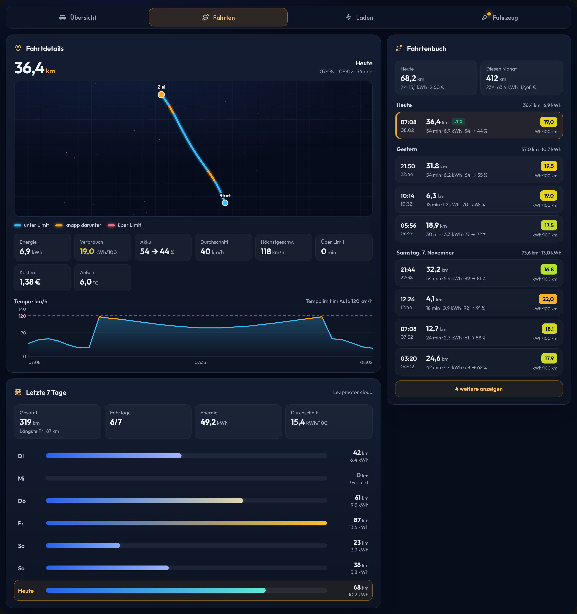
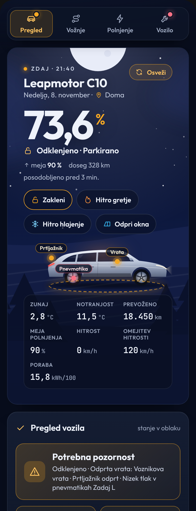
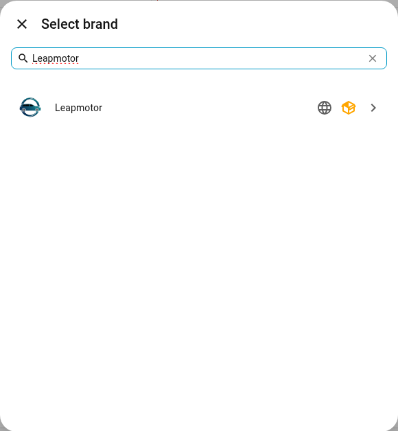
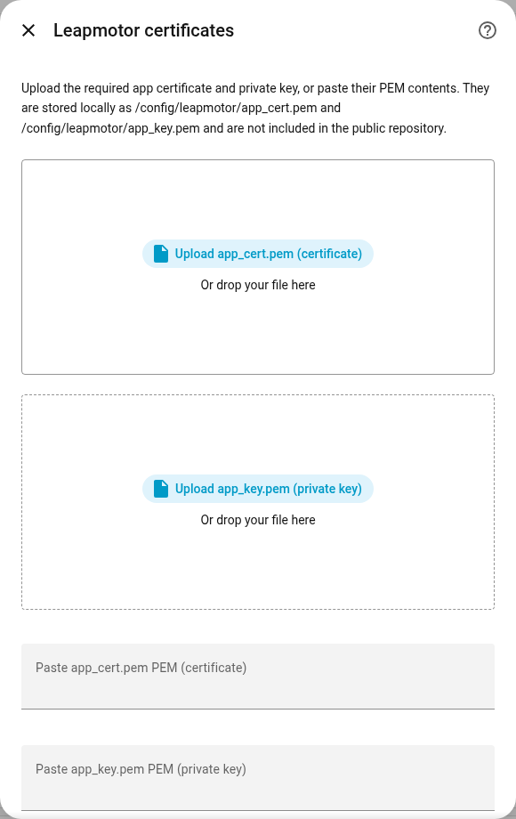
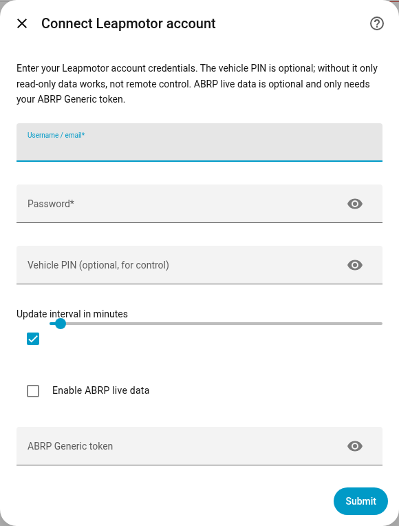

<p align="center">
  
</p>

<p align="center">
  <a href="https://hacs.xyz/"></a>
  
  
  
  <a href="LICENSE"></a>
</p>

<p align="center">
  <b>Your Leapmotor, at home in Home Assistant.</b><br>
  Battery, charging, doors, windows, tires, a trip log, charging costs and remote control —<br>
  plus a built-in night-sky dashboard that installs itself.
</p>

<p align="center">
  <a href="#-install">Install</a> &nbsp;·&nbsp;
  <a href="#-manual-installation-step-by-step">Manual install</a> &nbsp;·&nbsp;
  <a href="#-the-dashboard">Dashboard</a> &nbsp;·&nbsp;
  <a href="#-services">Services</a> &nbsp;·&nbsp;
  <a href="#-troubleshooting">Troubleshooting</a>
</p>

<p align="center">
  🇸🇮 <b><a href="README.md">Slovensko</a></b>
</p>

<br>

## ✦ The dashboard

<p align="center">
  
</p>

One card, everything about the car. It ships **inside** the integration and is
loaded automatically — no Lovelace resource, no second download. Add a card and
type:

```yaml
type: custom:leapmotor-card
```

Four pages with tabs: **Overview** (car, vehicle check, remote control),
**Trips**, **Charging** and **Vehicle** (maintenance, tires, insights).

<table>
  <tr>
    <td width="33%" valign="top">
      <b>🌙 Live hero scene</b><br>
      <sub>Night or day sky that follows the sun, <b>your own car</b> — the official render of your model and colour from the Leapmotor cloud — and a glowing wallbox cable while it charges.</sub>
    </td>
    <td width="33%" valign="top">
      <b>✅ Vehicle check</b><br>
      <sub>“All secure” or “Needs attention” at a glance, with a status tile for lock, doors, windows, trunk, tires and data freshness.</sub>
    </td>
    <td width="33%" valign="top">
      <b>⚡ Charging &amp; costs</b><br>
      <sub>State of charge against your limit, live power, finish time, the charge limit (tap Set twice) — and what the last session and this month cost.</sub>
    </td>
  </tr>
  <tr>
    <td valign="top">
      <b>🛣️ Trips</b><br>
      <sub>Every drive grouped by day, and for each one the route on a map, a speed chart, energy, consumption, battery used and cost.</sub>
    </td>
    <td valign="top">
      <b>🗓️ Last 7 days</b><br>
      <sub>Kilometres, energy and consumption for every day, straight from the Leapmotor cloud.</sub>
    </td>
    <td valign="top">
      <b>🎛️ Remote control</b><br>
      <sub>Climate and Doors &amp; security groups: cabin presets, defrost, steering-wheel and mirror heating, trunk, windows, sentry, find car — tap twice to confirm.</sub>
    </td>
  </tr>
</table>

<table>
  <tr>
    <td width="68%" valign="top">
      
      <p align="center"><sub>Trips page: trip details with map and speed chart, trip log, last 7 days — German</sub></p>
    </td>
    <td width="32%" valign="top">
      
      <p align="center"><sub>Overview on a phone — Slovenščina, “Potrebna pozornost”</sub></p>
    </td>
  </tr>
</table>

The hero shows the same vehicle picture the integration downloads for
`image.<model>_vehicle_picture`, so your car appears in your colour (the
screenshots use a drawn stand-in because they come from demo data). The card
speaks the language of your Home Assistant profile (English,
Slovenščina, Deutsch) and adapts from a three-column wall display down to a
phone. Every value opens Home Assistant's detail dialog when you click it.
Full options: **[docs/card.md](docs/card.md)**.

<br>

## ✦ Highlights

| | |
| --- | --- |
| 🔋 **Vehicle state** | Battery (also high-precision), range, odometer, speed, gear, READY/ON3, interior & outdoor temperature |
| 🔌 **Charging** | Plugged-in / charging / finished, power, current, voltage, finish time, **settable charge limit** (also on the T03, the way LeapConnect sets it), schedule switch, EVCC helpers |
| 🚪 **Body** | Lock, four doors, trunk, four windows with position, panoramic roof, sunshade |
| 🛞 **Tires** | Pressure for every wheel |
| 📍 **Location** | GPS device tracker with sign-correction for known backend issues |
| 🛣️ **Trip log** | Every drive detected automatically: distance, duration, energy, kWh/100 km, average and top speed, battery used. Sensors for the last trip, today and this month |
| 🗺️ **Trip map** | The route of every trip on a dark map, coloured by speed — tap a trip in the log to show it. Polls every minute while driving |
| 🚦 **Speed limit** | The car's speed-limit setting, a *Speeding* sensor with your own alert speed, time above the limit per trip |
| ⚡ **Quick buttons** | Lock/unlock, quick heat, quick cool and open/close windows right under the battery on the first page |
| 🚗 **Live car picture** | The car on the card shows open doors, trunk, windows and sunroof, low tires, unlocked, climate heating or cooling, sentry, driving and charging |
| 💶 **Charging costs** | Charging sessions detected automatically and priced with your tariffs for home, public AC and public DC — including a **low (night) tariff** for home. Sensors for the last session and this month |
| 🔥 **Cabin preheat & pre-cool** | One tap to heat (your temperature, fan 7, recirculation) or cool (18 °C, fan 7, A/C) the cabin — or **auto**, which picks heat or cool from the outside temperature. Presets per vehicle, works on the T03 |
| 🔧 **Maintenance** | Factory schedules for T03, B10, C10 and C10 REEV (plus common items), due dates by km and time, *Done* button to log a service. Works from day one — assumes services were on schedule until you log one |
| 🛡️ **More controls** | Sentry mode, healthy charging, start/stop charging and sunroof |
| 💡 **Insights** | Cost per trip and per 100 km, parked battery drain, temperature-compensated **slow-leak tire detection**, consumption vs. your usual for similar trips and by outside temperature, an *attention needed* sensor, charge-to-limit cost now vs. low tariff |
| 🤖 **Blueprints** | Ready-made automations: pre-condition before departure, charging complete, car left unlocked (with auto-lock), plug-in reminder, attention/tire/maintenance alerts, speeding alert |
| ❤️ **Battery health** | State-of-health estimate from full-charge readings, against your car's capacity or the best value measured |
| 📊 **History** | Last-7-days mileage & energy with daily detail, six-week average consumption, weekly and daily energy split |
| 🌡️ **Comfort** | Climate on/off, quick heat/cool, defrost, steering-wheel & mirror heating, seat heating/ventilation 0–3, one-touch *prepare car* |
| 🧭 **Navigation** | Send a destination to the car |
| 🚗 **Multi-vehicle** | Main and shared cars, each with its own PIN and ABRP token |
| 🛰️ **ABRP** | Optional live telemetry push per vehicle |
| 🌍 **Languages** | English and **Slovenščina** — Home Assistant picks the one set in your profile (de, es, fr, it, nl, pl, pt also included) |

<br>

## ✦ Before you start

> [!IMPORTANT]
> This is an unofficial project, not affiliated with or endorsed by Leapmotor.
> Use it at your own risk. Leapmotor can change its API at any time, and
> remote-control actions should only be used deliberately and with the car in a
> safe state.

You need:

- **Home Assistant 2025.3 or newer** (vehicle settings use config sub-entries).
- Your **Leapmotor account** e-mail and password.
- The Leapmotor app **client certificate** files `app_cert.pem` and
  `app_key.pem`. They are app-level material, not personal credentials, and are
  **not** included in this repository.
- *Optional:* the **vehicle PIN** — only needed for remote control.

> [!TIP]
> Create a second Leapmotor account, share the car with it in the official app,
> and use that shared account in Home Assistant. Using the same account in both
> places can log the phone app out.

<br>

## ✦ Install

### HACS (recommended)

[](https://my.home-assistant.io/redirect/hacs_repository/?owner=sabotin&repository=leapmotor&category=integration)

1. Click the button above — or in HACS open **⋮ → Custom repositories**, add
   `https://github.com/sabotin/leapmotor` with type **Integration**.
2. Search for **Leapmotor** in HACS and **Download** it.
3. **Restart** Home Assistant.
4. Continue with [Set up the integration](#set-up-the-integration).

**Updating:** HACS installs from the `main` branch (there are no releases).
Open Leapmotor in HACS → **⋮ → Update information**, then **Redownload** and
restart Home Assistant. If the card still looks old, refresh the browser
(Ctrl + F5).

### ✦ Manual installation (step by step)

Use this if you don't use HACS. You need access to your Home Assistant
configuration folder (`/config`) — for example with the **Samba share**,
**Studio Code Server**, **File editor** or **Terminal & SSH** add-on.

**1. Download the code**

Download the repository as a ZIP:
**[sabotin/leapmotor → main.zip](https://github.com/sabotin/leapmotor/archive/refs/heads/main.zip)**
and unpack it on your computer.

**2. Copy the integration folder**

Copy the folder `custom_components/leapmotor` from the unpacked ZIP into your
Home Assistant config folder, so that this file exists:

```
/config/custom_components/leapmotor/manifest.json
```

If `custom_components` does not exist yet, create it. Copy the whole
`leapmotor` folder (including `frontend/` and `translations/`), not just its
contents.

<details>
<summary><b>Or do steps 1–2 in the Terminal & SSH add-on</b></summary>

```bash
cd /config && mkdir -p custom_components
```

```bash
wget -O /tmp/leapmotor.zip https://github.com/sabotin/leapmotor/archive/refs/heads/main.zip
```

```bash
rm -rf /tmp/leapmotor-src && unzip -q /tmp/leapmotor.zip -d /tmp/leapmotor-src
```

```bash
rm -rf /config/custom_components/leapmotor && cp -r /tmp/leapmotor-src/*/custom_components/leapmotor /config/custom_components/
```

```bash
ls /config/custom_components/leapmotor/manifest.json
```

</details>

**3. Add the certificates** *(optional now, you can also paste them during setup)*

Create the folder `/config/leapmotor/` and put `app_cert.pem` and
`app_key.pem` in it. This folder is outside `custom_components`, so updates
never delete your certificates.

**4. Restart Home Assistant**

**Settings → System → ⏻ (top right) → Restart Home Assistant**.

**5. Choose your language**

Click your name (bottom left) → **Language** → **English** or
**Slovenščina**. Entity names, the setup dialogs and the dashboard card all
follow this setting.

Then continue with [Set up the integration](#set-up-the-integration).

**Updating later:** repeat steps 1–2 (replace the folder) and restart.

### Set up the integration

1. **Settings → Devices & services → + Add integration → Leapmotor**.
2. **Certificates** — upload or paste `app_cert.pem` and `app_key.pem`
   (skipped automatically when they are already in `/config/leapmotor/`).
3. **Account** — e-mail, password, vehicle PIN (prefilled with the factory
   PIN 0000) and update interval.
4. Done — your car appears as a device with all its entities. Each vehicle is
   listed below the account entry; open it to set its PIN or ABRP token.

### The dashboard

**Plug and play:** after setup a **Leapmotor** entry appears in the sidebar
with the full dashboard — one per vehicle. Hide it with *Show the Leapmotor
dashboard in the sidebar* in the integration options.

You can also put the card on any dashboard: **+ Add card → Leapmotor**, or
`type: custom:leapmotor-card`.

If the card is not found, refresh the browser once with **Ctrl + F5**
(⌘ + Shift + R on macOS). In the companion app use
*Settings → Companion app → Debugging → Reset frontend cache*.

<br>

## ✦ Configuration

| Setting | Where | Notes |
| --- | --- | --- |
| E-mail & password | Setup | Required. Invalid credentials start re-authentication; **Reconfigure** lets you replace the password proactively. |
| Certificates | Setup / options | Required for the EU backend. Stored in `/config/leapmotor/`. |
| Vehicle PIN | Per vehicle | Prefilled with the factory PIN **0000** — change it if you set your own. Clear it to keep the car read-only. |
| Cabin presets | Per vehicle | Preheat (default 22 °C, fan 7, recirculation), pre-cool (default 18 °C, fan 7, recirculation) and the outside temperature above which *auto* cools (default 20 °C). |
| Severe-use schedule | Per vehicle | Shorter maintenance intervals for C10 (severe use) and T03 (city use). |
| Update interval | Options | In **minutes**. Diagnostics show it in seconds (`60` → `3600`). Use `1` for one-minute polling. |
| Eco polling | Options | Slows polling while every car is clearly locked, parked and unplugged. Minimum `5` minutes. Never wakes the car. |
| Interval while driving | Options | Default **1 minute** while a car is driving, so trip maps and the speed alert get enough points. Never slower than the update interval. |
| Speed alert | Per vehicle | The *Speeding* sensor turns on above this speed (km/h). `0` uses the speed limit set in the car, if it is switched on. |
| ABRP live data | Per vehicle | Optional. Needs only that car's ABRP *Generic* token — no API key. |
| Low tariff | Options | Optional home low-tariff price, start/end time (e.g. 22:00–06:00) and "all day on weekends" (two-rate tariffs such as MT/VT). Home sessions are split by time between the two prices. |
| Charging tariffs | Options | Price per kWh for **home**, **public AC** and **public DC**. A session counts as home when it starts inside your Home zone; DC when the car reports a DC cable or charges above 22 kW. Leave 0 to skip costs. Prices apply to sessions from then on. |
| Battery capacity | Per vehicle | Optional usable capacity in kWh (e.g. 69.9). Used as 100 % for battery health; leave 0 to compare with the best capacity measured. |

With several vehicles, entities are created per VIN and services accept either
`vin` or any Leapmotor `entity_id`. Existing single-vehicle settings migrate
automatically; on multi-vehicle accounts an old account-wide ABRP token is not
copied to every car — set it on the intended vehicle.

<details>
<summary><b>Behaviour notes</b></summary>

- The backend is **polled**, not streamed. Values can lag behind the car; use
  the `Last refresh` sensor and diagnostic age attributes in automations.
- Entity IDs are stable English slugs (e.g. `sensor.c10_battery`). Display
  names follow your Home Assistant language.
- Unavailable entities from older versions are not removed automatically.
  Remove and re-add the integration for a clean set.
- GPS sign issues are corrected only when the mirrored coordinate is clearly
  closer to your Home Assistant home location.
- EV consumption is exposed as `kWh/100 km`, plus `mi/kWh` when the API
  provides it.
- **Trip log and charging sessions** are worked out from the polled data, so
  their precision follows the update interval: set it to **1 minute** for
  exact start and end times and to catch short trips. Trips and sessions are
  stored locally in Home Assistant and survive restarts.
  Regenerated energy is not estimated — polling is too coarse for regen bursts.
- **Trip map** draws the route from the location history Home Assistant
  already records for the car's device tracker (and the speed sensor for the
  colours); the integration stores no extra location data. Points come once
  per update, so the line connects them straight. If Home Assistant's map
  cannot load, the card draws the route without a background map.
- **Speeding** is checked once per update, so it catches sustained speeding,
  not short bursts. Setting the car's own speed limit from Home Assistant is
  not supported (no verified command).
- **Charge limit on the T03** is sent like LeapConnect does (leapmotor-api
  0.6.0): command 190 built from the cloud's charging schedule, range
  50–100 % in steps of 5. If the car does not confirm it, it is sent once
  more — the same value twice is harmless. Switching the T03 charging
  schedule on or off stays unsupported.
- **Battery health** needs at least three days with a full (100 %) charge.
- **Trip comparison** keeps approximate trip start and end points (rounded to
  about 100 m) in Home Assistant's local storage, only to find similar trips.
  They are never exposed in attributes or diagnostics.
- **Tire warnings** flag a tire below 1.9 bar, 0.3 bar below the others, or
  falling 0.2 bar faster than the others against its 7-day median — so a cold
  morning does not trigger it, a slow leak does.
- **Last 7 days** covers today and the six previous calendar days in your
  Home Assistant time zone. `energy_complete` validates field and mileage
  coverage only, not physical accuracy. The original cloud day label stays in
  `daily_detail.source_date`.
- **B10:** daily `accumulatedEnergyConsume` is demonstrably unreliable (#67),
  so B10 daily `energy_kwh`, `driving_energy_kwh` and the rolling total stay
  unknown with `energy_unavailable_reason: unreliable_source`. Raw values,
  dates, mileage and coverage remain available; no scaling is applied.
- **T03:** daily energy is reported in Wh and converted to kWh
  (`daily_detail.energy_raw` keeps the source value). Charge-limit and
  charging-schedule writes are not supported — use the car or the official app.
  Read-only charge-limit values can be stale (`reliability: unverified`).
  Wallbox pauses with the observed idle signal are reported as connected
  (`plugged_in`, EVCC `B`); signal 1197 alone cannot identify DC on T03.
- **A10:** steering-wheel heating levels 1/2 and remote mode 3 are detected;
  unknown A10 modes stay unknown.
- Battery preheating is a stateful **switch**, so it can be turned on and off.
- The charging-schedule switch enables/disables the existing schedule while
  preserving its start, end, recurrence and charge limit.

</details>

<br>

## ✦ Services

All services live under `leapmotor.*` and accept `vin` or a Leapmotor
`entity_id`. Services that physically control the car require the vehicle PIN;
availability also depends on the model, the car's state and shared-car
permissions.

| Service | PIN | Purpose |
| --- | :---: | --- |
| `leapmotor.lock` / `leapmotor.unlock` | 🔒 | Lock or unlock |
| `leapmotor.unlock_charger` | 🔒 | Release the charging connector before unplugging |
| `leapmotor.trunk_open` / `leapmotor.trunk_close` | 🔒 | Open or close the trunk |
| `leapmotor.find_car` | 🔒 | Flash and honk |
| `leapmotor.windows_open` / `leapmotor.windows_close` | 🔒 | Windows, optional `value` 0–100 |
| `leapmotor.sunshade_open` / `leapmotor.sunshade_close` | 🔒 | Sunshade, optional `value` 0–10 |
| `leapmotor.ac_off` | 🔒 | Climate off |
| `leapmotor.set_climate` | 🔒 | `mode` (`cold`, `hot`, `wind`, `nohotcold`), `temperature` 18–32, `fan_speed` 1–7, `recirculate`, `windshield_defrost` |
| `leapmotor.set_climate_schedule` / `leapmotor.cancel_climate_schedule` | 🔒 | Pre-conditioning schedule |
| `leapmotor.prepare_car` | 🔒 | One-touch preparation: climate, seats, steering wheel, mirrors, optional navigation |
| `leapmotor.set_prepare_car_schedule` / `leapmotor.cancel_prepare_car_schedule` | 🔒 | Scheduled preparation |
| `leapmotor.quick_cool` / `leapmotor.quick_heat` | 🔒 | Climate quick profiles |
| `leapmotor.windshield_defrost` | 🔒 | Windshield defrost |
| `leapmotor.set_charge_limit` | 🔒 | `charge_limit_percent` |
| `leapmotor.preheat_cabin` | 🔒 | Heat with the vehicle preset; optional `temperature`, `fan_speed`, `recirculate` |
| `leapmotor.precool_cabin` | 🔒 | Cool with A/C using the vehicle preset; same optional fields |
| `leapmotor.precondition_cabin` | 🔒 | Cool when warm outside, otherwise heat |
| `leapmotor.charging_start` / `leapmotor.charging_stop` | 🔒 | Start or stop charging while plugged in |
| `leapmotor.sunroof_open` / `leapmotor.sunroof_close` | 🔒 | Sunroof, on cars that report one |
| `leapmotor.log_maintenance` | — | `service_type`, optional `odometer_km`, `date` |
| `leapmotor.reset_maintenance` | — | Forget a logged service |
| `leapmotor.send_destination` | — | `name`, `latitude`, `longitude`, optional `address` |
| `leapmotor.export_diagnostics` | — | Write a redacted support JSON |

Sentry mode and healthy charging are switches. The commands for sentry mode,
start/stop charging, healthy charging and the sunroof come from LeapConnect and
use the same verified remote-control flow; they have not yet been confirmed on
every model.

`set_climate_schedule` and `set_prepare_car_schedule` replace all existing
schedules with one entry. `start_time` must be in the future in the car's local
time; `days` uses `0 = Sunday` … `6 = Saturday`, an empty list means once.

<details>
<summary><b>Examples</b></summary>

Heat the cabin to 26 °C:

```yaml
action: leapmotor.set_climate
data:
  entity_id: sensor.c10_battery
  mode: hot
  temperature: 26
  fan_speed: 4
  recirculate: true
```

Pre-condition on Monday morning:

```yaml
action: leapmotor.set_climate_schedule
data:
  entity_id: sensor.c10_battery
  start_time: "2026-06-09 07:30:00"
  mode: hot
  temperature: 26
  fan_speed: 4
  days: [1]
```

Prepare the car now with cooling and seat ventilation:

```yaml
action: leapmotor.prepare_car
data:
  entity_id: sensor.c10_battery
  mode: cold
  temperature: 18
  fan_speed: 7
  recirculate: true
  driver_seat: ventilation
  driver_seat_level: 3
  passenger_seat: ventilation
  passenger_seat_level: 3
```

Release the charging connector:

```yaml
action: leapmotor.unlock_charger
data:
  entity_id: sensor.c10_battery
```

Disable the charging schedule:

```yaml
action: switch.turn_off
target:
  entity_id: switch.c10_charging_schedule
```

Send a destination:

```yaml
action: leapmotor.send_destination
data:
  entity_id: device_tracker.c10_location
  name: Ljubljana Center
  address: Prešernov trg, Ljubljana
  latitude: 46.05139
  longitude: 14.50611
```

</details>

<br>

## ✦ Blueprints

Import a ready-made automation with one click, then pick your car's entities:

| Blueprint | Import |
| --- | --- |
| **Pre-condition before departure** — preheat, pre-cool or auto at a set time on chosen days | [](https://my.home-assistant.io/redirect/blueprint_import/?blueprint_url=https%3A%2F%2Fgithub.com%2Fsabotin%2Fleapmotor%2Fblob%2Fmain%2Fblueprints%2Fautomation%2Fleapmotor%2Fprecondition_before_departure.yaml) |
| **Charging complete** — phone notification with battery and range | [](https://my.home-assistant.io/redirect/blueprint_import/?blueprint_url=https%3A%2F%2Fgithub.com%2Fsabotin%2Fleapmotor%2Fblob%2Fmain%2Fblueprints%2Fautomation%2Fleapmotor%2Fcharging_complete.yaml) |
| **Car left unlocked** — notify, optionally lock automatically | [](https://my.home-assistant.io/redirect/blueprint_import/?blueprint_url=https%3A%2F%2Fgithub.com%2Fsabotin%2Fleapmotor%2Fblob%2Fmain%2Fblueprints%2Fautomation%2Fleapmotor%2Fleft_unlocked.yaml) |
| **Plug-in reminder** — evening reminder when home, low and unplugged | [](https://my.home-assistant.io/redirect/blueprint_import/?blueprint_url=https%3A%2F%2Fgithub.com%2Fsabotin%2Fleapmotor%2Fblob%2Fmain%2Fblueprints%2Fautomation%2Fleapmotor%2Fplug_in_reminder.yaml) |
| **Attention, tires & maintenance** — alerts with the reason | [](https://my.home-assistant.io/redirect/blueprint_import/?blueprint_url=https%3A%2F%2Fgithub.com%2Fsabotin%2Fleapmotor%2Fblob%2Fmain%2Fblueprints%2Fautomation%2Fleapmotor%2Fattention_alert.yaml) |
| **Speeding alert** — speed and limit on your phone | [](https://my.home-assistant.io/redirect/blueprint_import/?blueprint_url=https%3A%2F%2Fgithub.com%2Fsabotin%2Fleapmotor%2Fblob%2Fmain%2Fblueprints%2Fautomation%2Fleapmotor%2Fspeed_alert.yaml) |

<br>

## ✦ ABRP & EVCC

**ABRP** telemetry is optional and off by default. Open the vehicle below the
Leapmotor account entry, enable *ABRP live data* and paste that car's ABRP
Generic token. Tokens are VIN-scoped, so one car's data never reaches another
car's token.

**EVCC** can read everything it needs from Home Assistant: SOC, range, plug
state, charging, `evcc_status`, charging power/current/voltage, odometer and
`charging_finish_time`.

<br>

## ✦ Troubleshooting

| Problem | Fix |
| --- | --- |
| HACS can't install | Add the repository as type **Integration**, then restart. |
| Certificate or login errors | Upload/paste both PEM files, or place them as `/config/leapmotor/app_cert.pem` and `app_key.pem`. |
| Login `code 21` / wrong account or password | If the same credentials work in the app: log out fully, change/reset the password once in the official app, retry. |
| Phone app keeps logging out | Use a second account with shared vehicle access. |
| Stale or wrong values | Press **Refresh data**, check **Last refresh**, then run `leapmotor.export_diagnostics`. |
| Remote control does nothing | Configure the vehicle PIN; check account and shared-car permissions. |
| *Token is invalid* / *Leapmotor rejected the session* | The integration logs in again and retries on its own. If it keeps happening, the official app is probably signed in with the same account — use a second account with the car shared to it. |
| *Leapmotor accepted the command but did not confirm the result* | The command most likely reached the car. Wait a few seconds and check its state before sending it again. |
| Card not found | Hard-refresh the browser (Ctrl + F5) or reset the companion-app frontend cache. |

<details>
<summary><b>Debug logging</b></summary>

```yaml
logger:
  default: info
  logs:
    custom_components.leapmotor: debug
```

Restart after editing `configuration.yaml`. Logs show sanitised API status
codes, polling-mode changes and flow details. Check logs for account data,
VINs, locations, tokens and certificate material before sharing them — for
public issues prefer `leapmotor.export_diagnostics`.

</details>

<details>
<summary><b>China / Rest of the World beta (upstream 0.8.0b4)</b></summary>

The upstream project publishes an experimental
[EU/CN beta 0.8.0b4](https://github.com/kerniger/leapmotor-ha/releases/tag/v0.8.0b4)
that adds **China / Rest of the World** to the setup. 0.7.5 — the version in
this repository — is the stable release; CN support there is experimental and
read-only (telemetry, binary sensors, manual refresh, phone/SMS or session
import, optional per-entry proxy). Controls, lock status, windows, climate,
navigation, location, history, ABRP, EVCC and vehicle images are not available
for CN yet. See the upstream
[CN guide](https://github.com/kerniger/leapmotor-ha/blob/v0.8.0b4/docs/cn/README.md).

</details>

<details>
<summary><b>Recent fixes</b></summary>

- **0.7.5** — A10 steering-wheel heating state for levels 1/2 and remote mode
  3; B10 daily energy withheld as `unreliable_source`; CI tests the minimum
  HA 2025.3.0 and the newest release.
- **0.7.4** — Password recovery and reconfiguration, HA-local history dates,
  T03 daily Wh → kWh, connected-idle / EVCC `B` for T03 wallbox pauses.
- **0.7.3** — Diagnostics privacy, energy metadata and T03 charge-control
  restrictions. Details: [docs/issue-fixes-20260923.md](docs/issue-fixes-20260923.md).

Full history in [CHANGELOG.md](CHANGELOG.md).

</details>

<br>

## ✦ Setup screenshots

<table>
  <tr>
    <td width="33%"><p align="center"><sub>Add integration</sub></p></td>
    <td width="33%"><p align="center"><sub>Certificates</sub></p></td>
    <td width="33%"><p align="center"><sub>Account</sub></p></td>
  </tr>
</table>

<br>

## ✦ Credits

- The integration is based on **[leapmotor-ha](https://github.com/kerniger/leapmotor-ha)**
  by [kerniger](https://github.com/kerniger) (MIT). All the hard reverse-engineering
  work is theirs; this repository adds the redesign, the dashboard card and the
  Slovenian translation.
- The trip log, charging sessions, time-of-use pricing, trip comparison,
  battery-health estimate and maintenance engine are ported from
  **[LeapConnect](https://github.com/markoceri/leapconnect)** by
  [Marco Mancino](https://github.com/markoceri) (AGPL-3.0); the extra remote
  commands come from his [leapmotor-api](https://pypi.org/project/leapmotor-api/)
  and the maintenance schedules from his
  [maintenance packs](https://github.com/markoceri/leapconnect-maintenance-packs) (MIT).
- [sbstn-0x2a](https://github.com/sbstn-0x2a) — raw-signal mappings for charging,
  doors, climate, heating, seating, range and diagnostics.
- [markoceri](https://github.com/markoceri) — public Leapmotor API and
  certificate research.
- [Mikado8231](https://github.com/Mikado8231) — A10 heating fix and HA test matrix.
- Looking for trip logs and charge history with its own web UI? Try
  [leapmotor-mate](https://github.com/ProtossBlaster/leapmotor-mate).
- Fonts: [Outfit](https://github.com/Outfitio/Outfit-Fonts) and
  [JetBrains Mono](https://github.com/JetBrains/JetBrainsMono), SIL Open Font License 1.1.

<br>

## ✦ Legal

Read [LEGAL.md](LEGAL.md) and [SECURITY.md](SECURITY.md) before publishing
logs, diagnostics or modified builds. Never post certificates, tokens, VINs or
precise locations.

**GNU AGPL-3.0** — see [LICENSE](LICENSE). Third-party notices, including the
original MIT licence of leapmotor-ha, are in [NOTICE.md](NOTICE.md).

<p align="center"><br><br><sub>Made for Leapmotor drivers · not affiliated with Leapmotor</sub></p>
