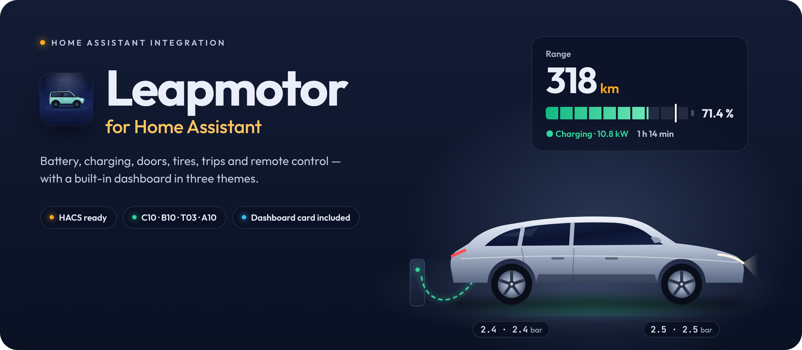
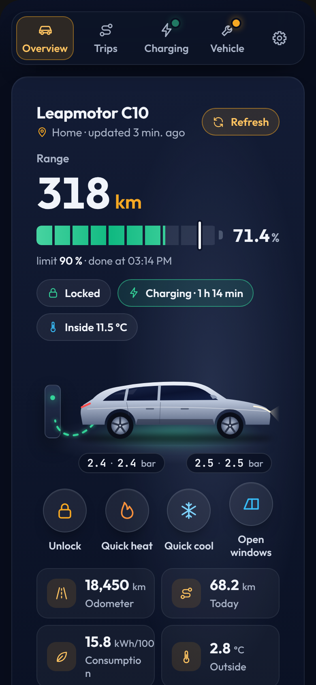
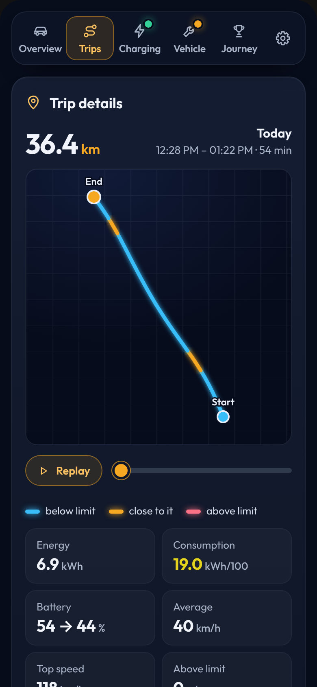
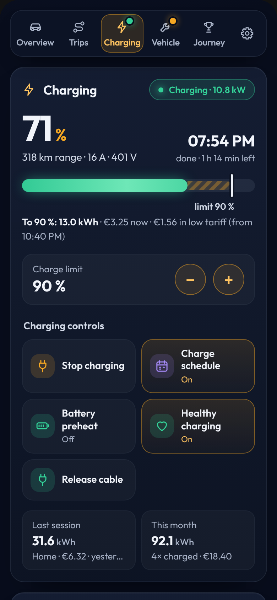
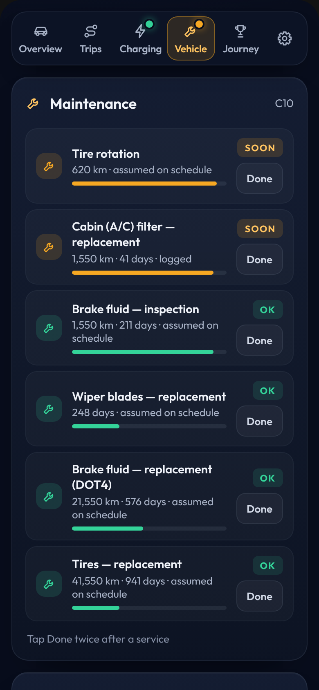
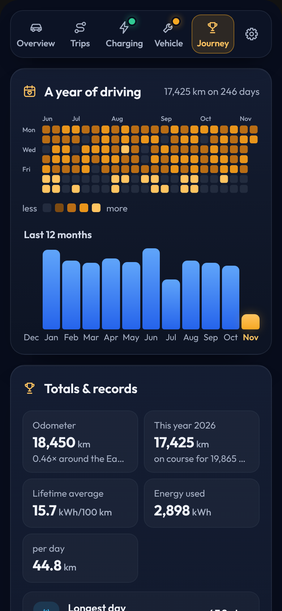
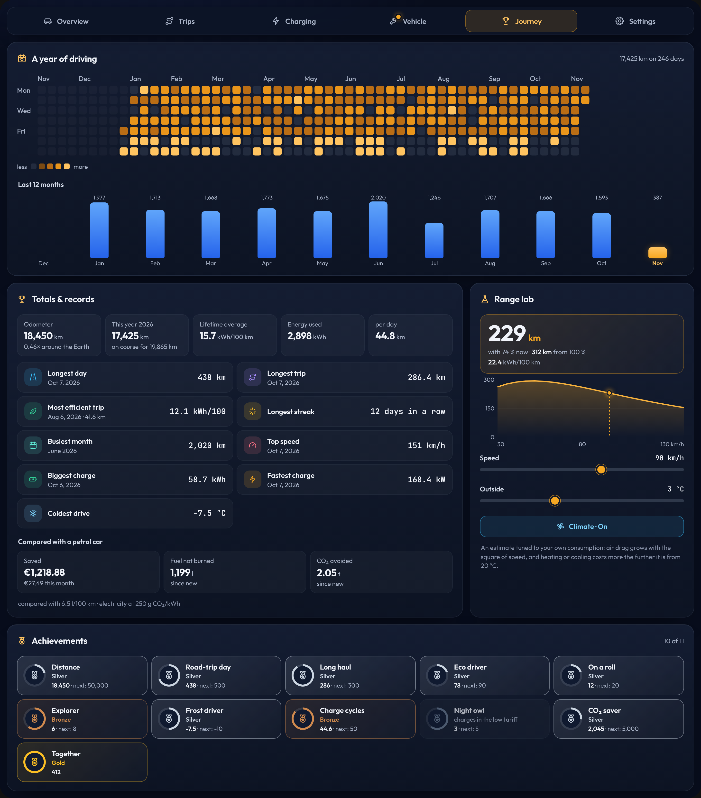
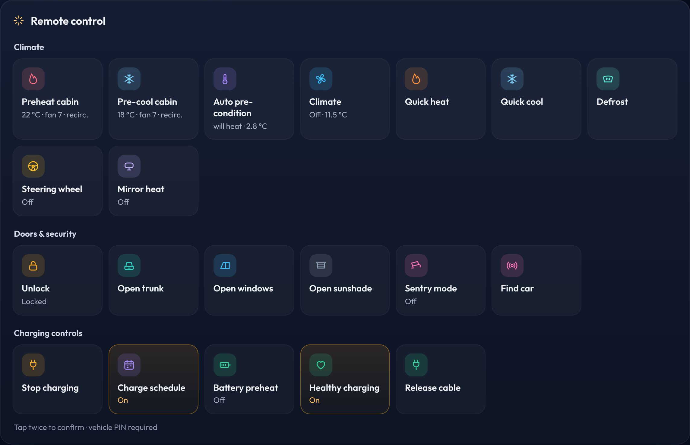

<p align="center">
  
</p>

<p align="center">
  <a href="https://hacs.xyz/"></a>
  
  
  <a href="LICENSE"></a>
</p>

<p align="center">
  <b>Your Leapmotor in Home Assistant.</b><br>
  An overview of your car, battery, charging, trips and costs, plus remote control.
</p>

<p align="center">🇸🇮 <a href="README.md">Slovensko</a></p>

<br>

## What the integration does

- **Vehicle status:** battery, range, lock, doors, windows, tires and location.
- **Heating and cooling:** quick heating to 22 °C or cooling to 18 °C. Automatic cabin preparation based on the outside temperature is also available.
- **Charging and costs:** set the charge limit (also on the T03), and see each charging session and its cost at home and at public AC and DC chargers. A low (off-peak) tariff is supported too.
- **Trip log:** distance, consumption and cost of each trip.
- **Trip map:** the route of each trip, coloured by speed.
- **Speed alert:** a warning when you go faster than your set speed or the limit set in the car.
- **Car picture:** shows the state of the doors, trunk, windows, climate, charging and driving.
- **Maintenance:** service schedule for the T03, B10, C10 and C10 REEV.
- **Extra data:** battery health, battery drain while parked and a warning when a tire is slowly losing pressure.
- **Learns your routine:** from your own trips it works out when the car usually leaves and how far it goes on each weekday. It tells you whether the battery is enough for tomorrow and can warm up the car before you leave, without a schedule.
- **Real range:** the range worked out from your own consumption at the current outside temperature, next to the car's figure.
- **Journey:** a year of driving on a calendar, your records, an eco score for each trip, achievements, and the money, fuel and CO₂ saved compared with a petrol car.
- **Trip replay and export:** replay a trip on the map and export the trip log as CSV.
- **Charging curve and history:** charging power over battery level, a warning when the car charges slower than usual, and the charging history from the cloud with place and cost.
- **Car software and messages:** a notice when Leapmotor offers a new software version, with the release notes, and the messages from the Leapmotor app.
- **Remote control:** locking, trunk, windows, sentry mode, charging and more.
- **Automations:** ready-made automations you can import into Home Assistant.
- **Language:** the integration is available in English and Slovenian.

<p align="center">
  
</p>

<br>

## Installation

### What you need

- Home Assistant 2025.3 or newer and [HACS](https://hacs.xyz/).
- The e-mail and password of your Leapmotor account. I recommend a second account that the car is shared with, so the official app doesn't log you out.
- The app certificates: `app_cert.pem` and `app_key.pem`. They are not included in the repository; you need to get them yourself.
- The vehicle PIN is set to `0000` by default. If you changed it in the car, change it here too.

### Install with HACS

[](https://my.home-assistant.io/redirect/hacs_repository/?owner=Sabotin&repository=LeapBridge&category=integration)

1. In HACS open **⋮ → Custom repositories**.
2. Add `https://github.com/Sabotin/LeapBridge` and choose the type **Integration**.
3. Search for **Leapmotor**, click **Download** and restart Home Assistant.
4. Open **Settings → Devices & services → Add integration → Leapmotor**.
5. Upload both certificates and enter your account details. When setup is done, Leapmotor appears in the sidebar.

**Updating:** HACS installs the latest release (the first one is 0.7.5). When a new release is out, the update appears in HACS and among the updates in Home Assistant's settings; download it and restart Home Assistant. If you do not see it yet, open Leapmotor in HACS and choose **⋮ → Update information**. If you installed the integration before the first release, choose **Redownload** once and restart Home Assistant. If the card still looks old, refresh the browser with **Ctrl + F5**.

Manual installation and detailed instructions: **[English guide](docs/guide-en.md)**.

<br>

## Dashboard

After installation, **Leapmotor** appears in the sidebar on its own. The dashboard is ready to use, so there is nothing else to set up.

If you have several cars, each one gets its own dashboard.

If you don't want it in the sidebar, you can hide it in **Leapmotor → Configure** (the *Show the Leapmotor dashboard in the sidebar* switch).

The dashboard has five tabs and an extra **Settings** tab. A dot on a tab means there is something to look at on that page. The screenshots below show the Car app theme.

<table>
  <tr>
    <td width="20%" valign="top"></td>
    <td width="20%" valign="top"></td>
    <td width="20%" valign="top"></td>
    <td width="20%" valign="top"></td>
    <td width="20%" valign="top"></td>
  </tr>
  <tr>
    <td valign="top"><b>Overview</b><br><sub>Battery status, quick buttons to unlock, heat, cool and open the windows, the outlook for the next day, a vehicle check and what happened in the last 24 hours.</sub></td>
    <td valign="top"><b>Trips</b><br><sub>Each trip with a map, replay, speed, consumption, battery, cost and eco score. There is also a day-by-day trip log with CSV export, the last 7 days and your frequent routes.</sub></td>
    <td valign="top"><b>Charging</b><br><sub>Charging overview, the charge-limit setting, the last 24 hours, battery health, the charging curve and the charging history.</sub></td>
    <td valign="top"><b>Vehicle</b><br><sub>Maintenance, tires, extra data on costs, battery drain and consumption by temperature, the car software and messages.</sub></td>
    <td valign="top"><b>Journey</b><br><sub>A year of driving on a calendar, totals and records, the comparison with a petrol car, a range lab and achievements.</sub></td>
  </tr>
</table>

<p align="center">
  
</p>

You can also add the card to a dashboard you already have:

**Add card → Leapmotor**

Or add it manually:

```yaml
type: custom:leapmotor-card
```

There are three themes: Classic (day or night sky), Driver display (gauges around the car) and Car app.

In the **Settings** tab, each user can pick the theme, day or night display and the language. The settings apply to that user on every device.

While the car is charging, a wallbox is shown next to it.

If the card isn't found after installation, refresh the browser once with **Ctrl + F5**.

<br>

## Heating, cooling and remote control

<p align="center">
  
</p>

There are three ways to get the cabin ready:

- **Preheat cabin:** 22 °C, fan 7, recirculation only.
- **Pre-cool cabin:** A/C, 18 °C, fan 7.
- **Auto pre-condition:** cools if it is warmer than 20 °C outside, otherwise heats.

You can change all of these on the vehicle under **Devices & services → Leapmotor → vehicle → Configure**.

Commands that affect the car's security have to be confirmed with a double tap.

After a service, double-tap **Done** under **Maintenance** to start the service interval again.

<br>

## Settings

Some settings are on the account, others on each vehicle.

| What | Where |
| --- | --- |
| Charging price at home, public AC and DC, low tariff | **Leapmotor → Configure** (the cog on the account) |
| Fuel price and consumption of a comparable petrol car, CO₂ of your electricity (for the savings) | **Leapmotor → Configure** |
| PIN, preheat, pre-cool, battery capacity, speed alert | On the **vehicle** under the account → **Configure** |
| How often to record while driving (for the map) | **Leapmotor → Configure**, 1 minute by default |
| Showing Leapmotor in the sidebar | **Leapmotor → Configure** |
| Language | Click your name at the bottom left → **Language** |

<br>

## Automations

Some common tasks already have ready-made automations. Import them straight into Home Assistant and adjust them to your setup if needed.

| Automation | |
| --- | --- |
| **Pre-condition before your usual departure** (the time is learned from your trips) | [](https://my.home-assistant.io/redirect/blueprint_import/?blueprint_url=https%3A%2F%2Fgithub.com%2FSabotin%2FLeapBridge%2Fblob%2Fmain%2Fblueprints%2Fautomation%2Fleapmotor%2Fsmart_precondition.yaml) |
| **Plug in for tomorrow** (only when the battery is not enough for the next day) | [](https://my.home-assistant.io/redirect/blueprint_import/?blueprint_url=https%3A%2F%2Fgithub.com%2FSabotin%2FLeapBridge%2Fblob%2Fmain%2Fblueprints%2Fautomation%2Fleapmotor%2Fsmart_charge_reminder.yaml) |
| **Notify when something happens with the car** (trip, charging, cable, message, update) | [](https://my.home-assistant.io/redirect/blueprint_import/?blueprint_url=https%3A%2F%2Fgithub.com%2FSabotin%2FLeapBridge%2Fblob%2Fmain%2Fblueprints%2Fautomation%2Fleapmotor%2Fcar_event_notification.yaml) |
| **Slow charging alert** | [](https://my.home-assistant.io/redirect/blueprint_import/?blueprint_url=https%3A%2F%2Fgithub.com%2FSabotin%2FLeapBridge%2Fblob%2Fmain%2Fblueprints%2Fautomation%2Fleapmotor%2Fslow_charging_alert.yaml) |
| **Pre-condition before departure** (pick the time and days) | [](https://my.home-assistant.io/redirect/blueprint_import/?blueprint_url=https%3A%2F%2Fgithub.com%2FSabotin%2FLeapBridge%2Fblob%2Fmain%2Fblueprints%2Fautomation%2Fleapmotor%2Fprecondition_before_departure.yaml) |
| **Notification when charging is complete** | [](https://my.home-assistant.io/redirect/blueprint_import/?blueprint_url=https%3A%2F%2Fgithub.com%2FSabotin%2FLeapBridge%2Fblob%2Fmain%2Fblueprints%2Fautomation%2Fleapmotor%2Fcharging_complete.yaml) |
| **Alert if the car is left unlocked** (or lock it automatically) | [](https://my.home-assistant.io/redirect/blueprint_import/?blueprint_url=https%3A%2F%2Fgithub.com%2FSabotin%2FLeapBridge%2Fblob%2Fmain%2Fblueprints%2Fautomation%2Fleapmotor%2Fleft_unlocked.yaml) |
| **Plug-in reminder** (in the evening, when the battery is low) | [](https://my.home-assistant.io/redirect/blueprint_import/?blueprint_url=https%3A%2F%2Fgithub.com%2FSabotin%2FLeapBridge%2Fblob%2Fmain%2Fblueprints%2Fautomation%2Fleapmotor%2Fplug_in_reminder.yaml) |
| **Alerts** (doors, windows, tires, service) | [](https://my.home-assistant.io/redirect/blueprint_import/?blueprint_url=https%3A%2F%2Fgithub.com%2FSabotin%2FLeapBridge%2Fblob%2Fmain%2Fblueprints%2Fautomation%2Fleapmotor%2Fattention_alert.yaml) |
| **Speeding alert** (speed and limit on your phone) | [](https://my.home-assistant.io/redirect/blueprint_import/?blueprint_url=https%3A%2F%2Fgithub.com%2FSabotin%2FLeapBridge%2Fblob%2Fmain%2Fblueprints%2Fautomation%2Fleapmotor%2Fspeed_alert.yaml) |

<br>

## If something doesn't work

| Problem | What to try |
| --- | --- |
| Certificate error | The message tells you which file is wrong. Check that you are using a matching pair of certificates. |
| Wrong password (`code 21`) | If logging in works in the app, log out, change your password once in the app and try again. |
| The app keeps logging you out | Try a second account that the car is shared with from your main account. |
| A command doesn't work | Check the vehicle PIN and the shared account's permissions. |
| *Token is invalid* | The integration tries to log in again on its own. If the error keeps coming back, use a second account with the car shared to it. |
| Data is out of date | Tap **Refresh** on the card. The data comes from the cloud, so there can be a short delay. |

<br>

## Credits

- The integration is based on **[leapmotor-ha](https://github.com/kerniger/leapmotor-ha)** by [kerniger](https://github.com/kerniger) (MIT).
- The trip log, charging costs, maintenance and extra commands are ported from **[LeapConnect](https://github.com/markoceri/leapconnect)** by [Marco Mancino](https://github.com/markoceri) (AGPL-3.0).

**License:** GNU AGPL-3.0. See [LICENSE](LICENSE) and [NOTICE.md](NOTICE.md).

Unofficial project, not affiliated with Leapmotor. You use it at your own risk.

<p align="center"><br><br><sub>Made for Leapmotor drivers</sub></p>
