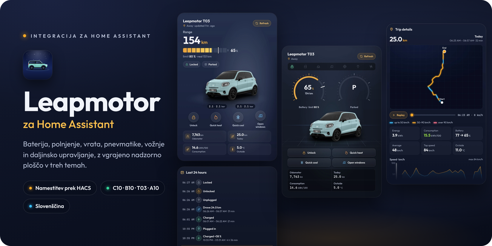
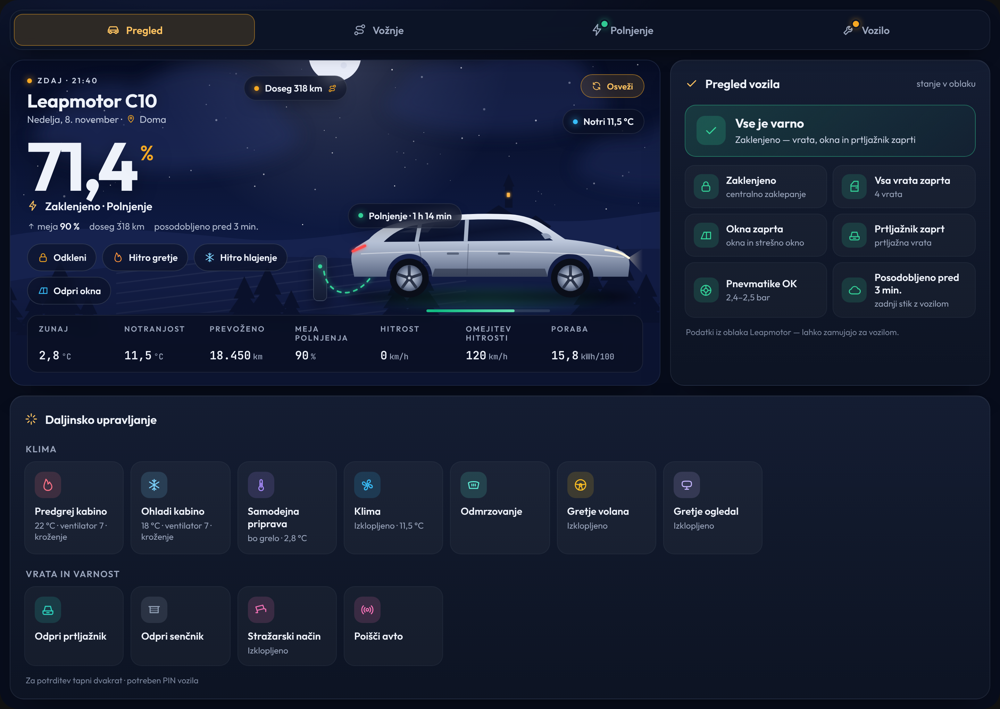
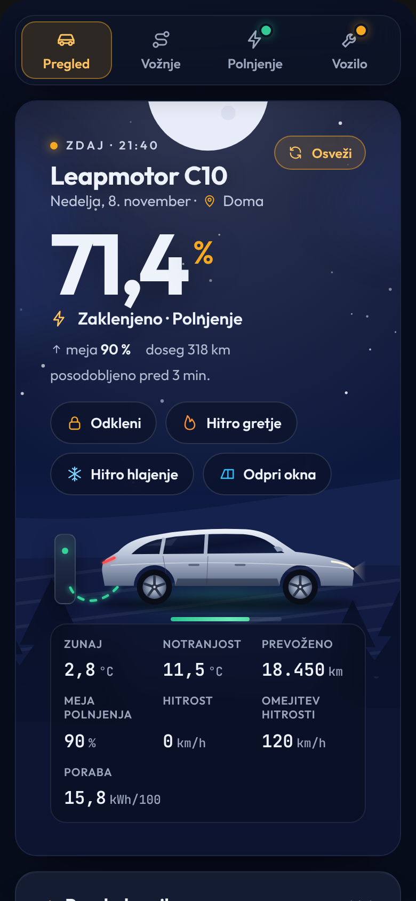
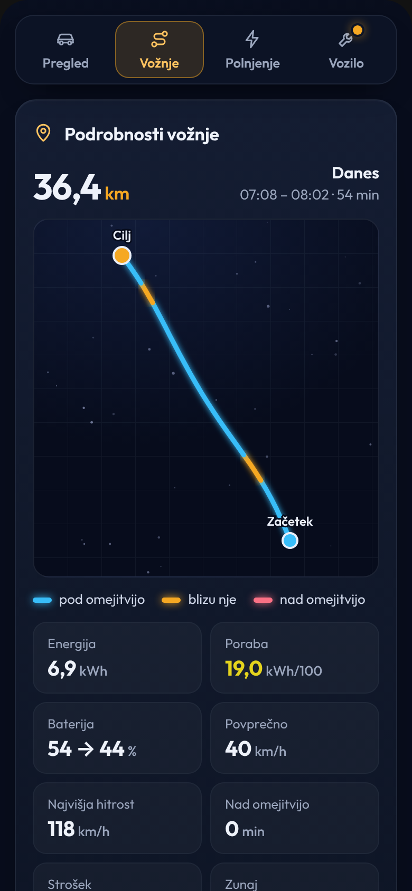
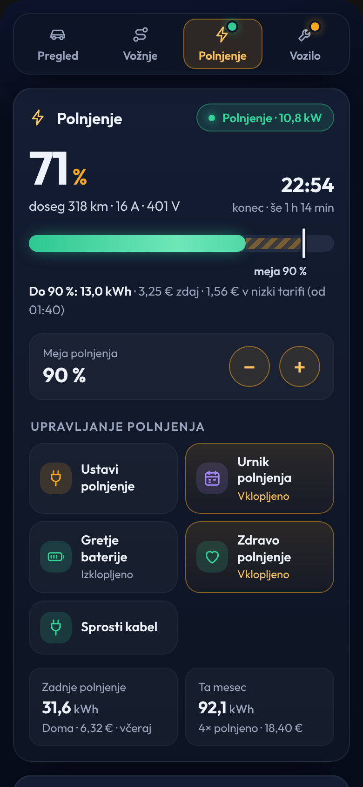
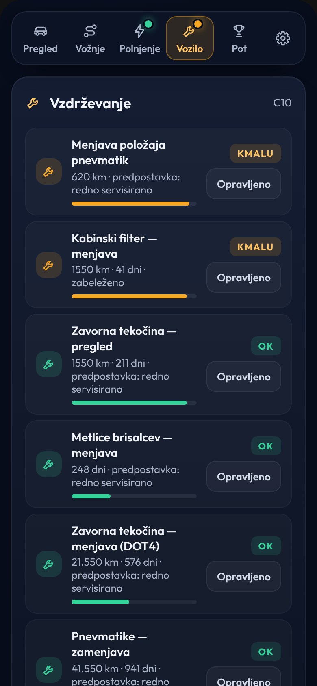
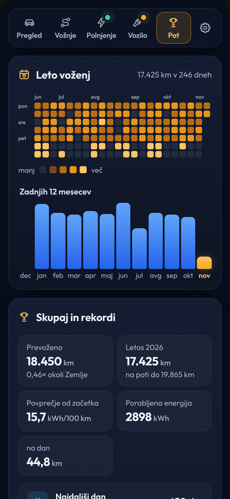
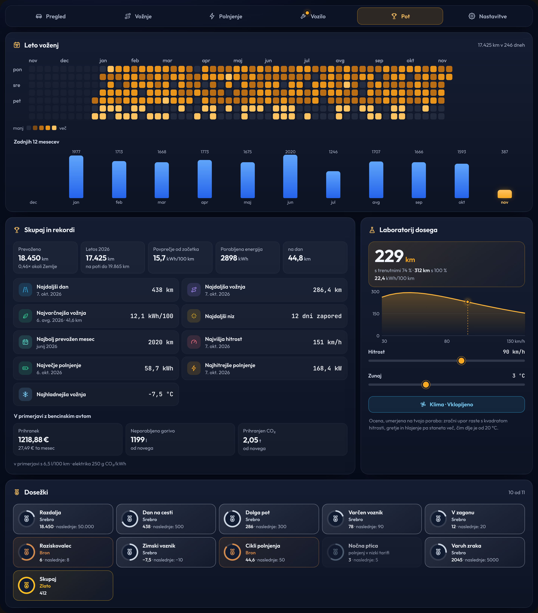
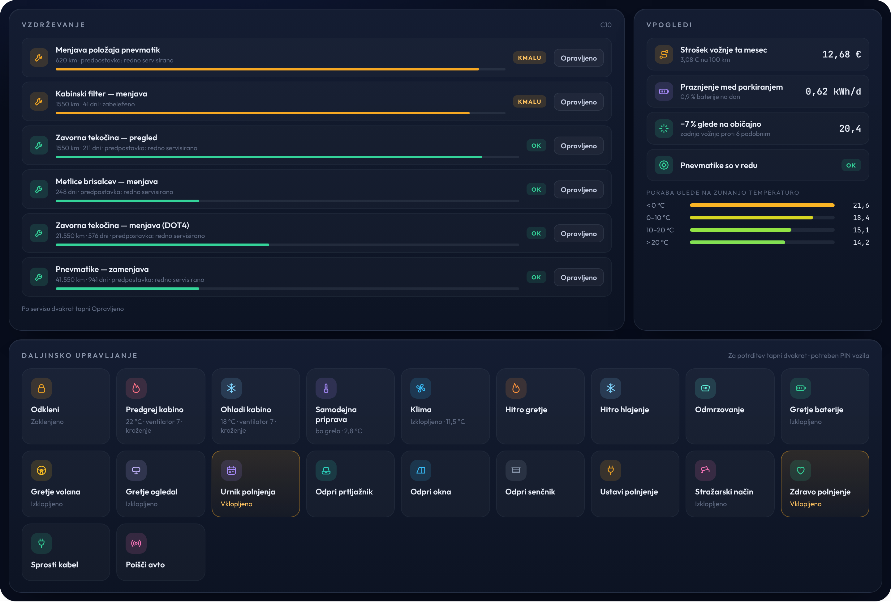

<p align="center">
  
</p>

<p align="center">
  <a href="https://hacs.xyz/"></a>
  
  
  <a href="LICENSE"></a>
</p>

<p align="center">
  <b>Tvoj Leapmotor v Home Assistantu.</b><br>
  Pregled vozila, baterije, polnjenja, voženj in stroškov ter upravljanje na daljavo.
</p>

<p align="center">🇬🇧 <a href="README.en.md">English</a></p>

<br>

## Kaj omogoča integracija

- **Stanje vozila:** baterija, doseg, ključavnica, vrata, okna, pnevmatike in lokacija.
- **Gretje in hlajenje:** hitro ogrevanje na 22 °C ali hlajenje na 18 °C. Na voljo je tudi samodejna priprava kabine glede na zunanjo temperaturo.
- **Polnjenje in stroški:** nastavitev meje polnjenja (tudi na T03), pregled posameznih polnjenj in stroškov doma ter na javnih AC in DC polnilnicah. Podprta je tudi nizka tarifa (MT/VT).
- **Dnevnik voženj:** razdalja, poraba in strošek posamezne vožnje.
- **Zemljevid voženj:** prikaz poti, obarvan glede na hitrost.
- **Opozorilo za hitrost:** opozorilo, ko presežeš nastavljeno hitrost ali omejitev v vozilu.
- **Prikaz vozila:** stanje vrat, prtljažnika, oken, klime, polnjenja in vožnje.
- **Vzdrževanje:** servisni načrt za T03, B10, C10 in C10 REEV.
- **Dodatni podatki:** zdravje baterije, praznjenje med parkiranjem in opozorilo ob počasnem izgubljanju tlaka v pnevmatiki.
- **Uči se tvojih navad:** iz tvojih voženj ugotovi, kdaj se z avtom običajno odpelješ in koliko prevoziš na posamezen dan v tednu. Pove ti, ali je baterije dovolj za jutri, in lahko pred odhodom ogreje avto, brez urnika.
- **Dejanski doseg:** doseg, izračunan iz tvoje porabe pri trenutni zunanji temperaturi, ob podatku iz avta.
- **Pot:** leto voženj na koledarju, tvoji rekordi, eko ocena vsake vožnje, dosežki ter prihranek denarja, goriva in CO₂ v primerjavi z bencinskim avtom.
- **Predvajanje in izvoz voženj:** predvajanje vožnje na zemljevidu in izvoz dnevnika voženj v CSV.
- **Polnilna krivulja in zgodovina:** moč polnjenja glede na stanje baterije, opozorilo, ko avto polni počasneje kot običajno, in zgodovina polnjenj iz oblaka s krajem in stroškom.
- **Programska oprema in sporočila:** obvestilo, ko Leapmotor ponudi novo različico programske opreme, z opisom novosti, ter sporočila iz aplikacije Leapmotor.
- **Upravljanje na daljavo:** zaklepanje, prtljažnik, okna, stražarski način, polnjenje in drugo.
- **Avtomatizacije:** pripravljene avtomatizacije, ki jih lahko uvoziš v Home Assistant.
- **Jezik:** integracija je na voljo v slovenščini in angleščini.

<p align="center">
  
</p>

<br>

## Namestitev

### Kaj potrebuješ

- Home Assistant 2025.3 ali novejši in [HACS](https://hacs.xyz/).
- E-pošto in geslo za račun Leapmotor. Priporočam uporabo drugega računa, s katerim si deliš vozilo, da te uradna aplikacija ne odjavlja.
- Certifikata aplikacije: `app_cert.pem` in `app_key.pem`. Datoteki nista vključeni v repozitorij, priskrbeti ju moraš sam.
- PIN vozila je privzeto nastavljen na `0000`. Če si ga v vozilu spremenil, ga spremeni tudi tukaj.

### Namestitev prek HACS

[](https://my.home-assistant.io/redirect/hacs_repository/?owner=Sabotin&repository=LeapBridge&category=integration)

1. V HACS odpri **⋮ → Poljubni repozitoriji**.
2. Dodaj `https://github.com/Sabotin/LeapBridge` in izberi vrsto **Integration**.
3. Poišči **Leapmotor**, klikni **Prenesi** in znova zaženi Home Assistant.
4. Odpri **Nastavitve → Naprave in storitve → Dodaj integracijo → Leapmotor**.
5. Naloži oba certifikata in vnesi podatke računa. Po končani namestitvi se v stranski vrstici pojavi Leapmotor.

**Posodobitev:** HACS namesti zadnjo izdajo (prva je 0.7.5). Ko izide nova izdaja, se posodobitev pokaže v HACS in med posodobitvami v nastavitvah Home Assistanta; prenesi jo in znova zaženi Home Assistant. Če je še ne vidiš, odpri Leapmotor v HACS in izberi **⋮ → Posodobi informacije** (*Update information*). Če si integracijo namestil pred prvo izdajo, enkrat izberi **Prenesi znova** (*Redownload*) in znova zaženi Home Assistant. Če je kartica še vedno stara, osveži brskalnik s **Ctrl + F5**.

Ročna namestitev in podrobnejša navodila: **[navodila v slovenščini](docs/navodila-sl.md)**.

<br>

## Nadzorna plošča

Po namestitvi se v stranski vrstici samodejno pojavi **Leapmotor**. Nadzorna plošča je že pripravljena, zato ti ni treba ničesar dodatno nastavljati.

Če imaš več vozil, ima vsako svojo nadzorno ploščo.

Če je ne želiš v stranski vrstici, jo lahko skriješ v **Leapmotor → Nastavi** (stikalo *Prikaži nadzorno ploščo v stranski vrstici*).

Nadzorna plošča ima pet zavihkov in dodatni zavihek **Nastavitve**. Pika ob zavihku pomeni, da je na tisti strani nekaj za pogledati. Spodnje slike prikazujejo temo Aplikacija.

<table>
  <tr>
    <td width="20%" valign="top"></td>
    <td width="20%" valign="top"></td>
    <td width="20%" valign="top"></td>
    <td width="20%" valign="top"></td>
    <td width="20%" valign="top"></td>
  </tr>
  <tr>
    <td valign="top"><b>Pregled</b><br><sub>Stanje baterije, hitri gumbi za odklepanje, gretje, hlajenje in okna, napoved za naslednji dan, pregled vozila in dogajanje v zadnjih 24 urah.</sub></td>
    <td valign="top"><b>Vožnje</b><br><sub>Posamezne vožnje z zemljevidom, predvajanjem, hitrostjo, porabo, baterijo, stroškom in eko oceno. Na voljo so tudi dnevnik po dnevih z izvozom v CSV, zadnjih 7 dni in pogoste poti.</sub></td>
    <td valign="top"><b>Polnjenje</b><br><sub>Pregled polnjenja, nastavitev meje polnjenja, podatki za zadnjih 24 ur, zdravje baterije, polnilna krivulja in zgodovina polnjenj.</sub></td>
    <td valign="top"><b>Vozilo</b><br><sub>Vzdrževanje, pnevmatike, dodatni podatki o stroških, praznjenju ter porabi glede na temperaturo, programska oprema avta in sporočila.</sub></td>
    <td valign="top"><b>Pot</b><br><sub>Leto voženj na koledarju, seštevki in rekordi, primerjava z bencinskim avtom, laboratorij dosega in dosežki.</sub></td>
  </tr>
</table>

<p align="center">
  
</p>

Kartico lahko dodaš tudi na svojo obstoječo nadzorno ploščo:

**Dodaj kartico → Leapmotor**

Ali jo dodaš ročno:

```yaml
type: custom:leapmotor-card
```

Na voljo so tri teme: klasična (dnevno ali nočno nebo), voznikov zaslon (merilniki ob avtu) in aplikacija.

Vsak uporabnik si lahko v zavihku **Nastavitve** izbere temo, dnevni ali nočni prikaz in jezik. Nastavitve veljajo za tega uporabnika na vseh napravah.

Med polnjenjem se ob avtomobilu prikaže tudi polnilnica.

Če kartice po namestitvi ne najde, enkrat osveži brskalnik s **Ctrl + F5**.

<br>

## Gretje, hlajenje in upravljanje vozila

<p align="center">
  
</p>

Za pripravo kabine so na voljo trije načini:

- **Predgrej kabino:** 22 °C, ventilator 7, samo kroženje zraka.
- **Ohladi kabino:** klima, 18 °C, ventilator 7.
- **Pripravi kabino samodejno:** če je zunaj več kot 20 °C, vklopi hlajenje, sicer gretje.

Vse nastavitve lahko spremeniš pri vozilu pod **Naprave in storitve → Leapmotor → vozilo → Nastavi**.

Ukaze, ki vplivajo na varnost vozila, je treba potrditi z dvojnim dotikom.

Po opravljenem servisu v zavihku **Vzdrževanje** dvakrat tapni **Opravljeno**, da se servisni rok začne znova.

<br>

## Nastavitve

Nekatere nastavitve so na voljo pri računu, druge pa pri posameznem vozilu.

| Kaj | Kje |
| --- | --- |
| Cena polnjenja doma, javno AC in DC, nizka tarifa | **Leapmotor → Nastavi** (zobnik pri računu) |
| Cena goriva in poraba primerljivega bencinskega avta, CO₂ tvoje elektrike (za izračun prihranka) | **Leapmotor → Nastavi** |
| PIN, predgretje, hlajenje, kapaciteta baterije, opozorilo na hitrost | Pri **vozilu** pod računom → **Nastavi** |
| Pogostost beleženja med vožnjo (za zemljevid) | **Leapmotor → Nastavi**, privzeto 1 minuta |
| Prikaz Leapmotorja v stranski vrstici | **Leapmotor → Nastavi** |
| Jezik | Klikni svoje ime spodaj levo → **Jezik** |

<br>

## Avtomatizacije

Za nekatere pogoste stvari so že pripravljene avtomatizacije. Uvoziš jih neposredno v Home Assistant in po potrebi prilagodiš svojim nastavitvam.

| Avtomatizacija | |
| --- | --- |
| **Priprava kabine pred običajnim odhodom** (uro se nauči iz tvojih voženj) | [](https://my.home-assistant.io/redirect/blueprint_import/?blueprint_url=https%3A%2F%2Fgithub.com%2FSabotin%2FLeapBridge%2Fblob%2Fmain%2Fblueprints%2Fautomation%2Fleapmotor%2Fsmart_precondition.yaml) |
| **Priključi za jutri** (samo ko baterije ni dovolj za naslednji dan) | [](https://my.home-assistant.io/redirect/blueprint_import/?blueprint_url=https%3A%2F%2Fgithub.com%2FSabotin%2FLeapBridge%2Fblob%2Fmain%2Fblueprints%2Fautomation%2Fleapmotor%2Fsmart_charge_reminder.yaml) |
| **Obvestilo, ko se z avtom kaj zgodi** (vožnja, polnjenje, kabel, sporočilo, posodobitev) | [](https://my.home-assistant.io/redirect/blueprint_import/?blueprint_url=https%3A%2F%2Fgithub.com%2FSabotin%2FLeapBridge%2Fblob%2Fmain%2Fblueprints%2Fautomation%2Fleapmotor%2Fcar_event_notification.yaml) |
| **Opozorilo ob počasnem polnjenju** | [](https://my.home-assistant.io/redirect/blueprint_import/?blueprint_url=https%3A%2F%2Fgithub.com%2FSabotin%2FLeapBridge%2Fblob%2Fmain%2Fblueprints%2Fautomation%2Fleapmotor%2Fslow_charging_alert.yaml) |
| **Priprava kabine pred odhodom** (izbira ure in dni) | [](https://my.home-assistant.io/redirect/blueprint_import/?blueprint_url=https%3A%2F%2Fgithub.com%2FSabotin%2FLeapBridge%2Fblob%2Fmain%2Fblueprints%2Fautomation%2Fleapmotor%2Fprecondition_before_departure.yaml) |
| **Obvestilo, ko je polnjenje končano** | [](https://my.home-assistant.io/redirect/blueprint_import/?blueprint_url=https%3A%2F%2Fgithub.com%2FSabotin%2FLeapBridge%2Fblob%2Fmain%2Fblueprints%2Fautomation%2Fleapmotor%2Fcharging_complete.yaml) |
| **Opozorilo, če avto ostane odklenjen** (ali samodejno zaklepanje) | [](https://my.home-assistant.io/redirect/blueprint_import/?blueprint_url=https%3A%2F%2Fgithub.com%2FSabotin%2FLeapBridge%2Fblob%2Fmain%2Fblueprints%2Fautomation%2Fleapmotor%2Fleft_unlocked.yaml) |
| **Opomnik za polnjenje** (zvečer, ko je baterija prazna) | [](https://my.home-assistant.io/redirect/blueprint_import/?blueprint_url=https%3A%2F%2Fgithub.com%2FSabotin%2FLeapBridge%2Fblob%2Fmain%2Fblueprints%2Fautomation%2Fleapmotor%2Fplug_in_reminder.yaml) |
| **Opozorila** (vrata, okna, pnevmatike, servis) | [](https://my.home-assistant.io/redirect/blueprint_import/?blueprint_url=https%3A%2F%2Fgithub.com%2FSabotin%2FLeapBridge%2Fblob%2Fmain%2Fblueprints%2Fautomation%2Fleapmotor%2Fattention_alert.yaml) |
| **Opozorilo za prehitro vožnjo** (hitrost in omejitev na telefon) | [](https://my.home-assistant.io/redirect/blueprint_import/?blueprint_url=https%3A%2F%2Fgithub.com%2FSabotin%2FLeapBridge%2Fblob%2Fmain%2Fblueprints%2Fautomation%2Fleapmotor%2Fspeed_alert.yaml) |

<br>

## Če kaj ne deluje

| Težava | Kaj poskusiti |
| --- | --- |
| Napaka pri certifikatu | Sporočilo pove, katera datoteka je napačna. Preveri, ali uporabljaš ustrezen par certifikatov. |
| Napačno geslo (`code 21`) | Če prijava deluje v aplikaciji, se odjavi, enkrat spremeni geslo v aplikaciji in poskusi znova. |
| Aplikacija te odjavlja | Poskusi z drugim računom, ki ima vozilo deljeno z glavnim računom. |
| Ukaz ne deluje | Preveri PIN vozila in pravice deljenega računa. |
| *Token is invalid* | Integracija se poskusi samodejno znova prijaviti. Če se napaka ponavlja, uporabi drugi račun z deljenim vozilom. |
| Podatki niso aktualni | Na kartici tapni **Osveži**. Podatki prihajajo iz oblaka, zato lahko pride do manjše zamude. |

<br>

## Zahvale

- Integracija temelji na projektu **[leapmotor-ha](https://github.com/kerniger/leapmotor-ha)** avtorja [kerniger](https://github.com/kerniger) (MIT).
- Dnevnik voženj, stroški polnjenja, vzdrževanje in dodatni ukazi so preneseni iz projekta **[LeapConnect](https://github.com/markoceri/leapconnect)** avtorja [Marco Mancino](https://github.com/markoceri) (AGPL-3.0).

**Licenca:** GNU AGPL-3.0. Več v datotekah [LICENSE](LICENSE) in [NOTICE.md](NOTICE.md).

Neuradni projekt, ki ni povezan z družbo Leapmotor. Uporabljaš ga na lastno odgovornost.

<p align="center"><br><br><sub>Narejeno za voznike Leapmotor</sub></p>
