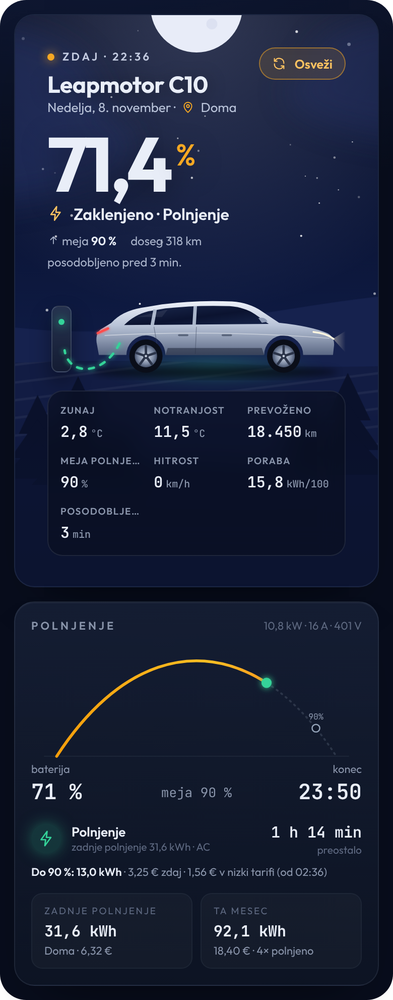
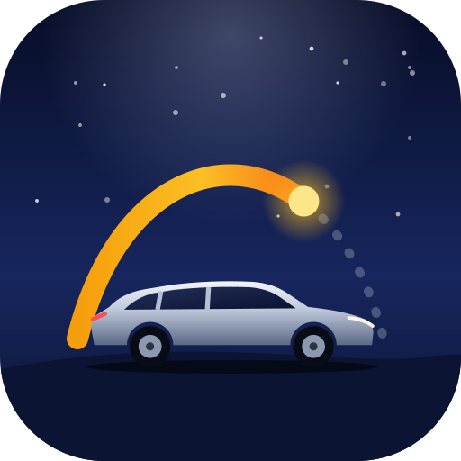

  

  
  
  
  

  <b>Tvoj Leapmotor v Home Assistantu.</b> 
  Baterija, polnjenje, vožnje, stroški, vzdrževanje in daljinsko upravljanje — 
  vse na eni lepi nadzorni plošči.

🇬🇧 <a href="README.en.md">English</a>

 

## ✦ Kaj dobiš

- 🔋 **Stanje vozila** — baterija, doseg, ključavnica, vrata, okna, pnevmatike, lokacija
- 🔥 **Predgretje in hlajenje** — en dotik: ogrej (22 °C) ali ohladi s klimo (18 °C), ventilator 7, kroženje zraka; ali **samodejno** glede na zunanjo temperaturo
- ⚡ **Polnjenje in stroški** — vsako polnjenje s ceno za dom, javno AC in DC, tudi **nizka tarifa** (MT/VT)
- 🛣️ **Dnevnik voženj** — razdalja, poraba in strošek vsake vožnje ter primerjava z običajnimi vožnjami
- 🔧 **Vzdrževanje** — tovarniški servisni načrt za T03, B10, C10 in C10 REEV
- 💡 **Vpogledi** — zdravje baterije, praznjenje med parkiranjem, opozorilo, ko pnevmatika počasi pušča
- 🎛️ **Daljinsko upravljanje** — zaklepanje, prtljažnik, okna, stražarski način, polnjenje …
- 🤖 **Avtomatizacije** — pripravljene na en klik
- 🇸🇮 **V slovenščini** — ali angleščini, kakor imaš nastavljeno v profilu

  

 

## ✦ Namestitev

**Kaj potrebuješ**

- Home Assistant 2025.3 ali novejši in [HACS](https://hacs.xyz/)
- e-pošto in geslo za račun Leapmotor — najbolje **drugi račun**, s katerim deliš vozilo, da te aplikacija ne odjavlja
- certifikat aplikacije: `app_cert.pem` in `app_key.pem` (nista del repozitorija, priskrbiš ju sam)
- PIN vozila je že vpisan (**0000**) — spremeni ga, če si ga v vozilu zamenjal

**Prek HACS**

1. HACS → **⋮** → **Poljubni repozitoriji** → `https://github.com/Sabotin/Leapmotor`, vrsta **Integration**.
2. Poišči **Leapmotor** → **Prenesi** → znova zaženi Home Assistant.
3. **Nastavitve → Naprave in storitve → Dodaj integracijo → Leapmotor**.
4. Naloži oba certifikata in vpiši račun. Končano. 🎉

Ročna namestitev brez HACS in vse podrobnosti: **[navodila v slovenščini](docs/navodila-sl.md)**.

 

## ✦ Nadzorna plošča

<table>
  <tr>
    <td width="62%" valign="top">
      Kartica se naloži sama — ničesar ni treba dodajati.
      <ol>
        <li><b>Nastavitve → Nadzorne plošče → Dodaj nadzorno ploščo</b>.</li>
        <li>Odpri jo → <b>✎ Uredi</b> → vrsta pogleda <b>Pano (ena kartica)</b>.</li>
        <li><b>Dodaj kartico → Leapmotor</b>.</li>
      </ol>
      Ali ročno:
      <pre>type: custom:leapmotor-card</pre>
      Na telefonu se kartica sama preuredi v en stolpec. Ponoči je nočno nebo, podnevi dnevno, med polnjenjem pa se ob avtu prižge polnilnica.
        
      Če kartice ne najde, enkrat osveži brskalnik (<b>Ctrl + F5</b>).
    </td>
    <td width="38%" valign="top">
      
    </td>
  </tr>
</table>

 

## ✦ Predgretje, hlajenje in upravljanje

  

- **Predgrej kabino** — 22 °C, ventilator 7, samo kroženje zraka
- **Ohladi kabino** — klima, najnižja temperatura 18 °C, ventilator 7
- **Pripravi kabino (samodejno)** — hladi, ko je zunaj topleje od 20 °C, sicer greje

Vse vrednosti spremeniš pri vozilu: **Naprave in storitve → Leapmotor →** vozilo **→ Nastavi**.
Vsak ukaz za varnost potrdiš z **dvojnim dotikom**.

Pri **Vzdrževanju** po servisu dvakrat tapni **Opravljeno** in rok se začne znova.

 

## ✦ Nastavitve

| Kaj | Kje |
| --- | --- |
| Cena polnjenja doma, javno AC in DC, nizka tarifa | **Leapmotor → Nastavi** (zobnik pri računu) |
| PIN, predgretje, hlajenje, kapaciteta baterije | pri **vozilu** pod računom → **Nastavi** |
| Natančen dnevnik voženj | interval posodabljanja na **1 minuto** |
| Jezik | klikni svoje ime spodaj levo → **Jezik** |

 

## ✦ Avtomatizacije na en klik

| | |
| --- | --- |
| 🔥 **Pripravi kabino pred odhodom** — ob izbrani uri in dnevih |  |
| ⚡ **Polnjenje končano** — obvestilo na telefon |  |
| 🔓 **Avto ostal odklenjen** — obvestilo ali samodejno zaklepanje |  |
| 🔌 **Opomnik za polnjenje** — zvečer, ko je baterija nizka |  |
| ⚠️ **Opozorila** — vrata, okna, pnevmatike, servis |  |

 

## ✦ Težave?

| Težava | Rešitev |
| --- | --- |
| Napaka pri certifikatu | Sporočilo pove, katera datoteka je narobe. Naloži ujemajoč se par. |
| Napačno geslo (`code 21`) | Če deluje v aplikaciji: odjavi se, enkrat spremeni geslo v aplikaciji, poskusi znova. |
| Aplikacija te odjavlja | Uporabi drugi račun z deljenim vozilom. |
| Ukaz ne deluje | Preveri PIN vozila in pravice deljenega računa. |
| Zastareli podatki | Tapni **Osveži** na kartici. Podatki prihajajo iz oblaka in lahko malo zamujajo. |

 

## ✦ Zahvale

- Temelji na **[leapmotor-ha](https://github.com/kerniger/leapmotor-ha)** avtorja [kerniger](https://github.com/kerniger) (MIT).
- Dnevnik voženj, stroški polnjenja, vzdrževanje in dodatni ukazi so preneseni iz **[LeapConnect](https://github.com/markoceri/leapconnect)** avtorja [Marco Mancino](https://github.com/markoceri) (AGPL-3.0).

**Licenca:** GNU AGPL-3.0 — [LICENSE](LICENSE) in [NOTICE.md](NOTICE.md).
Neuradni projekt, ni povezan z družbo Leapmotor. Uporaba na lastno odgovornost.

  Narejeno za voznike Leapmotor 🚗⚡

