<p align="center">
  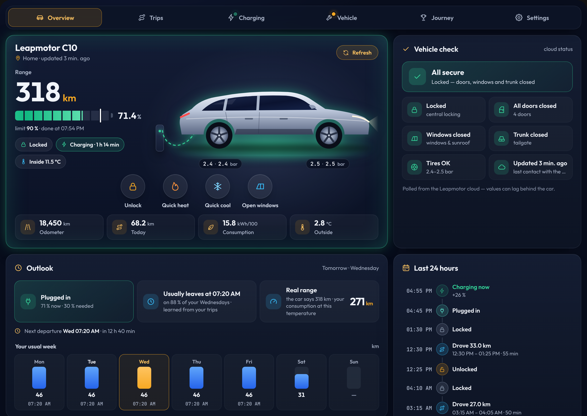
</p>

# Leapmotor dashboard card

A dashboard for your Leapmotor in three themes, shipped inside the integration.
Home Assistant loads it automatically once the integration is set up. There
is no Lovelace resource to add and nothing extra to install from HACS.

```yaml
type: custom:leapmotor-card
```

That is the whole configuration. The card finds your Leapmotor on its own and
follows the language and units of your Home Assistant profile.

---

## Pages

The card is split into five pages with tabs at the top, plus a **Settings** tab. A dot on a tab shows
when something on that page needs a look (open door, charging, driving,
maintenance, tires, slow charging or a software update).

| Page | Panels |
| --- | --- |
| **Overview** | Car and battery (with quick buttons), outlook, vehicle check, last 24 hours, remote control |
| **Trips** | Trip details (map, replay, stats, speed chart), trip log grouped by day, last 7 days, frequent routes |
| **Charging** | Charging with charge limit and charging controls, last 24 hours, battery & efficiency, charging curve, charging history |
| **Vehicle** | Maintenance, tires, insights, car software, messages |
| **Journey** | A year of driving, totals & records, range lab, achievements |
| **Settings** (gear) | Theme, day or night, and language for you (see [Settings](#settings)) |

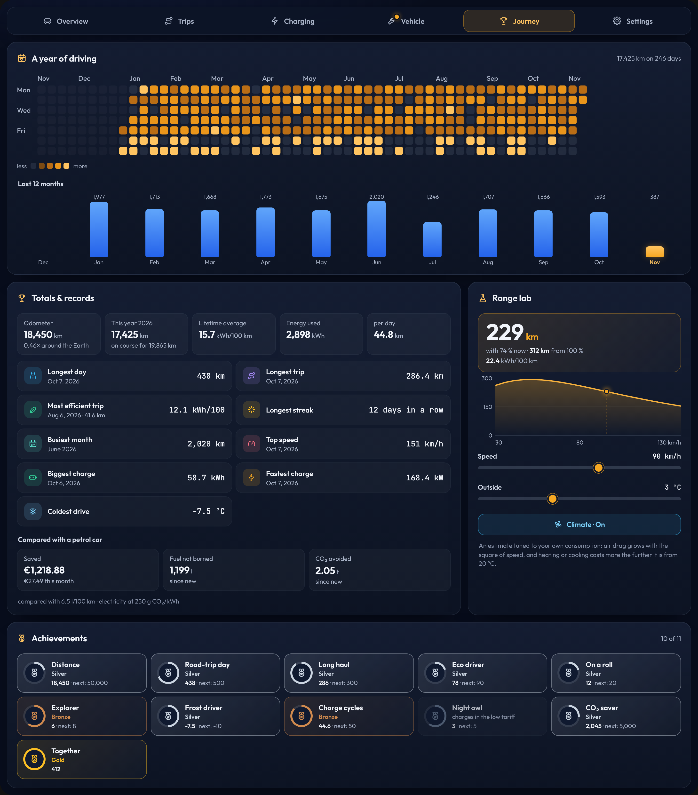

On a new installation the panels that learn from your driving (outlook,
frequent routes, records, achievements, the calendar) start with a short note
and fill up over the first days and weeks.

The card always opens on **Overview** (set `page` to start elsewhere). In the
Leapmotor sidebar panel the tabs stay at the top while you scroll. Set
`tabs: false` to show every page one below the other instead.

## Themes

The theme decides how the car panel on Overview looks and which surfaces the
panels use. Everything else (pages, panels, buttons, double-tap confirm) is the
same in all three.

| `look: classic` | `look: cluster` (driver display) | `look: console` (car app, the default) |
| --- | --- | --- |
| 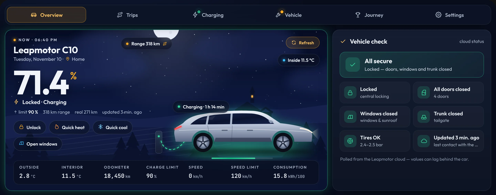 | 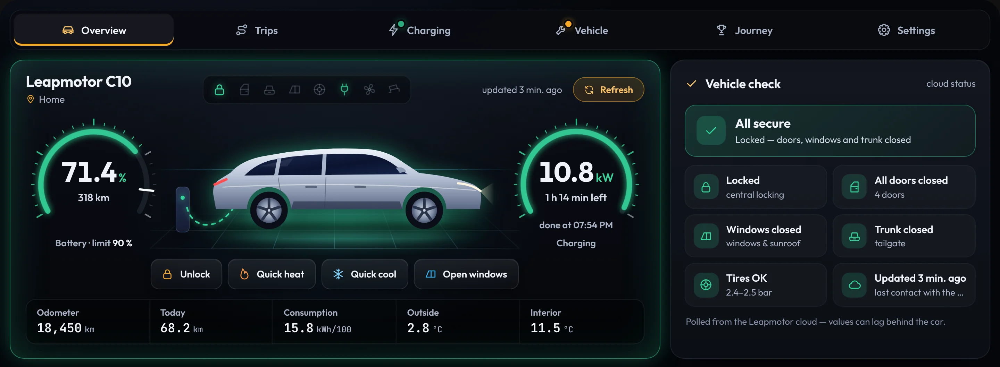 | 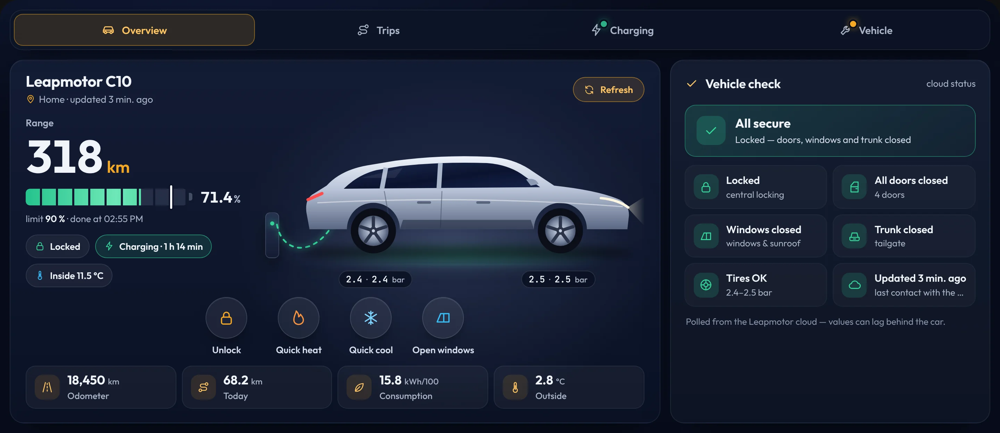 |
| 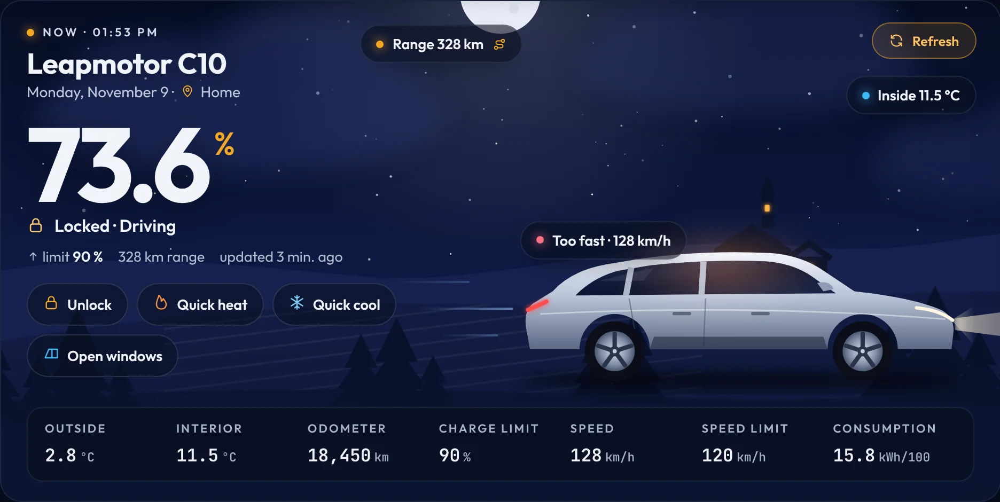 | 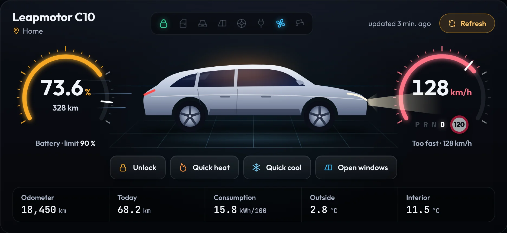 | 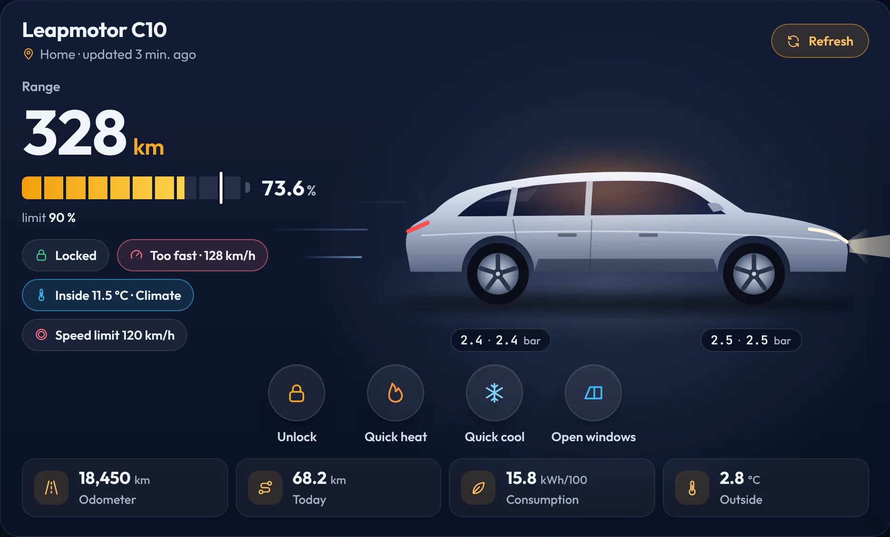 |
| 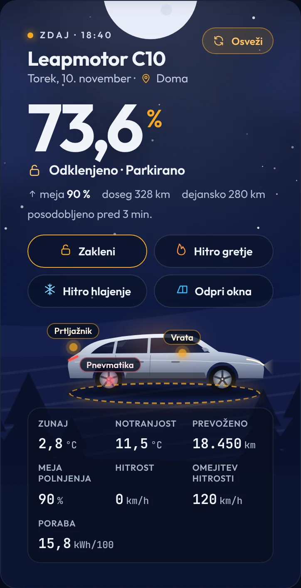 | 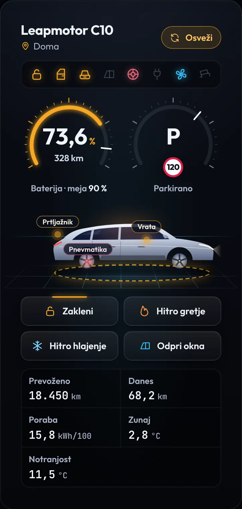 | 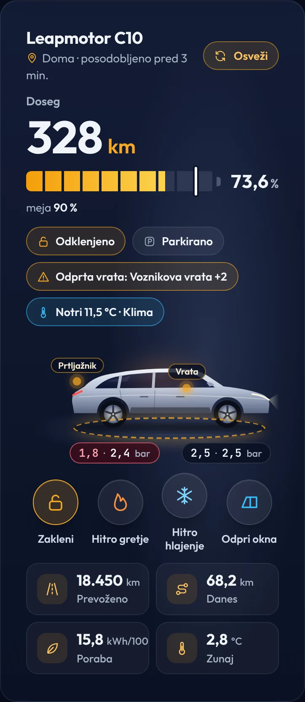 |

- **Classic:** the night or day sky with your car, the battery as a large
  figure and floating chips.
- **Driver display:** a battery gauge with range and the charge-limit mark,
  the car on a lit floor, a speed gauge with the speed-limit sign and
  P R N D (charging power and finish time while charging), warning lights and
  a trip-computer strip, on graphite panels.
- **Car app:** range as the headline, a segmented battery bar, status chips,
  tire pressures at the wheels and round quick buttons.

## Settings

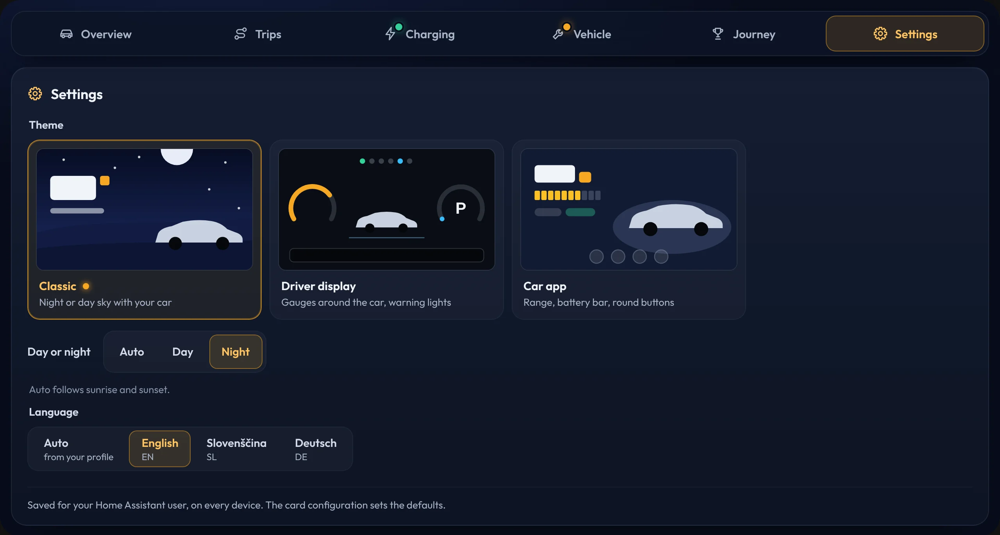

The **Settings** tab (gear, last tab) lets each person pick the theme, day or
night, and the language. The choice is saved for that Home Assistant user and
follows them to every device (in Home Assistant's own per-user frontend
storage; if that is not available, in the browser). It applies to all
Leapmotor cards and the Leapmotor sidebar panel. The card configuration
(`look`, `scene`, `language`) sets the defaults, and **Use card defaults**
goes back to them.

The tab is shown on cards that have tabs; set `settings: false` to hide it.

## Best layout

The card is built as a full dashboard and adapts to the space it gets:

| Width | Layout |
| --- | --- |
| ≥ 1180 px | Three columns per page |
| 760 – 1180 px | Two columns |
| < 760 px | One column, phone layout |

**The easiest way is already done for you:** the integration adds a
**Leapmotor** entry to the sidebar that shows this dashboard full screen, one
per vehicle. Switch it off in the integration options if you prefer your own
dashboard.

To build your own instead, create a dashboard and switch its view to
**Panel (single card)**:

1. **Settings → Dashboards → Add dashboard → New dashboard from scratch**.
2. Open it, click **✎ Edit**, then the pencil next to the view name.
3. Set **View type** to **Panel (single card)** and save.
4. **Add card → Leapmotor** (or *Manual* and paste `type: custom:leapmotor-card`).

In a Sections or Masonry view the card still works and uses the phone layout,
or pick just the parts you want with `sections` (see below).

## Options

| Option | Default | Description |
| --- | --- | --- |
| `device_id` | first Leapmotor | Which vehicle to show when you have more than one. The visual editor offers a picker. |
| `name` | `Leapmotor <model>` | Title shown in the hero. |
| `sections` | all | Any of `hero`, `outlook`, `check`, `timeline`, `controls`, `map`, `trips`, `week`, `routes`, `charging`, `chart`, `energy`, `curve`, `sessions`, `maintenance`, `tires`, `insights`, `software`, `inbox`, `calendar`, `records`, `rangelab`, `badges`. Order is fixed; the list picks what is shown. Pages without a section are left out, and with only one page left there are no tabs. |
| `tabs` | `true` | Split the card into the Overview, Trips, Charging, Vehicle and Journey pages. `false` shows everything on one page. |
| `page` | `overview` | The page the card opens on: `overview`, `trips`, `charging`, `vehicle`, `journey` or `settings`. |
| `settings` | `true` | Show the **Settings** tab, where each user picks the theme, day or night, and language. Only on cards with tabs. |
| `look` | `console` | Default theme (see [Themes](#themes)): `classic` (night or day sky), `cluster` (driver display) or `console` (car app). Each user can change it in the Settings tab. |
| `scene` | `auto` | Day or night: the sky in Classic, the display brightness in the other themes. `auto` follows `sun.sun`, or force `night` / `day`. Each user can change it in the Settings tab. |
| `language` | `auto` | `auto` follows your profile. Built in: `en`, `sl`, `de`. Each user can change it in the Settings tab. |
| `confirm_actions` | `true` | Remote actions, logging a service and setting the charge limit need a second tap within 4 seconds. |
| `backdrop` | `true` | Dark rounded backdrop behind the panels, so the card looks right on light themes too. |
| `show_image` | `true` | Show **your own car**: the official render of your model and colour that the integration downloads from the Leapmotor cloud (`image.<model>_vehicle_picture`). Falls back to a drawn silhouette until it is available. |
| `image` | – | Your own picture URL (a transparent PNG works best). |
| `image_flip` | `false` | Mirror the car picture if it faces the other way. The state markers (doors, trunk, tires) assume the car faces right. |
| `quick_actions` | `true` | Quick buttons under the battery on the first page: lock/unlock, quick heat, quick cool and open/close windows (same double-tap confirm as the remote-control panel). The remote-control panel then leaves these four out, so nothing is shown twice. |
| `map` | `auto` | `auto` draws trips on Home Assistant's own map (dark tiles); `drawn` always uses the map-less route drawing. |
| `entity_prefix` | – | Only needed if auto-discovery fails, e.g. `c10` for `sensor.c10_battery`. |
| `entities` | – | Override single entities, e.g. `{ battery: sensor.my_battery }`. Keys match the card's internal names (`battery`, `range`, `lock`, `tracker`, …). |

### Examples

A compact phone card with the hero and charging (two pages with tabs):

```yaml
type: custom:leapmotor-card
sections: [hero, charging]
```

Only the trips page, without tabs:

```yaml
type: custom:leapmotor-card
sections: [map, trips, week]
```

Just the outlook and the range lab, for a wall tablet:

```yaml
type: custom:leapmotor-card
sections: [outlook, rangelab]
```

Second vehicle, always at night, without confirmation taps:

```yaml
type: custom:leapmotor-card
device_id: 0123456789abcdef0123456789abcdef
name: Family B10
scene: night
confirm_actions: false
```

## What each panel shows

| Panel | Page | Contents |
| --- | --- | --- |
| **Hero** | Overview | Your car in the chosen theme, with wallbox and animated cable while plugged in. The car shows its state: open doors, trunk, windows and sunroof, low tires, an amber ring when unlocked, a warm or cool glow while the climate runs, sentry, motion and headlights while driving, and a battery bar while plugged in. *Classic:* night or day sky, the battery as a large figure, lock and driving state, location, range, inside temperature and a metric strip (outside/inside temperature, odometer, charge limit, speed, speed limit, consumption). *Driver display:* battery gauge with range and the charge limit, speed gauge with the speed limit sign and gear (charging power and finish time while charging), warning lights (lock, doors, trunk, windows, tires, cable, climate, sentry) and a trip-computer strip (odometer, today, consumption, outside and inside temperature). *Car app:* range, a segmented battery bar with the charge limit, lock/driving/charging chips, tire pressures at the wheels and a strip with odometer, today, consumption and outside temperature. All three have the quick buttons (lock/unlock, quick heat, quick cool, open/close windows). |
| **Vehicle check** | Overview | One glance answer: *All secure* or *Needs attention*, then a tile each for lock, doors, windows and sunroof, trunk, tires and data freshness (and the battery when it is below 20 %). Green is fine, amber needs a look, red is a problem. No buttons: unlock is in the hero, Find car in the remote control. |
| **Outlook** | Overview | What the next day needs, learned from your own trips: *Enough battery* or *Plug in tonight* with the battery now and the battery needed, when the car usually leaves on that weekday and how reliable that is, the **real range** from your own consumption at the current temperature next to the car's figure, the next predicted departure, and **your usual week** with the typical distance and first departure of each weekday. Shows a short note while it is still learning. |
| **Last 24 hours** (timeline) | Overview | A timeline of what happened: trips with distance and duration, charging with the percent gained, the cable plugged in and removed, and locking and unlocking. Read from Home Assistant's recorder. |
| **Remote control** | Overview | Grouped into *Climate* (preheat, pre-cool and auto pre-condition with your presets, climate, quick heat/cool, defrost, steering wheel and mirror heating) and *Doors & security* (trunk, windows, sunroof, sunshade, sentry mode, find car). Only what your car supports is shown. |
| **Trip details** | Trips | The selected trip (or the live one): distance, day, time and duration, the route on a dark map coloured by speed (blue below the limit, amber close to it, red above; without a limit: up to 50, 50–90, over 90 km/h), energy, consumption, battery used, average and top speed, minutes above the limit, cost and outside temperature, and a speed chart with the limit as a dashed line. Built from the device tracker and speed history in the recorder. |
| **Trip log** | Trips | Today and this month (distance, trips, energy, cost), then the last 30 trips grouped by day with the day's total. Each trip shows start and end time, distance, duration, energy, battery used, colour-coded consumption and its **eco score**; the latest also how it compares with similar trips. Tap a trip to open it in the trip details. **CSV** downloads the whole stored trip log (up to 500 trips) for a spreadsheet or a driver's logbook. |
| **Frequent routes** | Trips | The routes you drive most, named after your zones (Home → Work), each with the number of trips, typical distance, time, consumption and cost, the usual departure time and your best run. |
| **Last 7 days** | Trips | Total distance, driving days, energy and average consumption, and one bar per day with kilometres and kWh, from the Leapmotor cloud. |
| **Charging** | Charging | State of charge and range, charging power, current, voltage and finish time, a battery bar with the charge limit and the part still to charge, the energy and cost to reach the limit, the charge limit with − / + and a **Set** button (tap twice), charging controls (start/stop charging, charge schedule, battery preheat, healthy charging, release cable), and the last session and this month. |
| **Last 24 hours** | Charging | Battery, range or charging power now and its change over 24 hours, driven km and charged %, peak and lowest value, the curve with a scale, and a strip that shows when the car was parked, driving or charging. |
| **Battery & efficiency** | Charging | Battery health, the **capacity trend** per year with the date the battery is expected to reach 90 %, six-week average consumption on an efficiency scale and last week's driving/climate/other split. |
| **Charging curve** | Charging | Charging power over battery level for the session in progress (or the last fast charge) against your usual curve, with the peak power. A warning appears when an AC session is clearly slower than you usually get at that kind of place. |
| **Charging history** | Charging | The sessions the Leapmotor cloud keeps for the last 60 days: this month's energy, sessions and cost, the share charged at home, and each session with energy, duration, average power, place, AC or DC and cost. |
| **Maintenance** | Vehicle | The next six service items with status (OK / soon / overdue), km and days left, a progress bar and a **Done** button (tap twice) that logs the service. |
| **Tires** | Vehicle | All four pressures around a drawing of the car, with low, uneven and slowly dropping tires marked. |
| **Insights** | Vehicle | Driving cost this month and per 100 km, parked drain, last trip vs. your usual and consumption by outside temperature. |
| **Car software** | Vehicle | *Up to date* or *Update available* with the new version and download size, the installed version and since when, the release notes, the car's own climate schedules with the next run, and what the account is allowed to do with the car (useful on a shared account). |
| **Messages** | Vehicle | The latest messages from the Leapmotor app, unread ones marked. |
| **A year of driving** | Journey | A calendar of the last twelve months with one square per day, darker for more kilometres, and a bar for each month. |
| **Totals & records** | Journey | Odometer, this year with a projection, lifetime average consumption, energy used and distance per day; your longest day and trip, most efficient trip, longest driving streak, busiest month, top speed, biggest and fastest charge and coldest drive; and what you saved against a petrol car in money, fuel and CO₂. |
| **Range lab** | Journey | Move the speed and outside temperature sliders and switch the climate on or off to see how far the battery takes you, now and from 100 %, with a curve of range over speed. The estimate is tuned to your own consumption. |
| **Achievements** | Journey | Eleven badges in bronze, silver and gold with the progress to the next level. |

Click any value to open Home Assistant's detail dialog for that entity.

**Trip replay:** in the trip details, **Replay** drives a marker along the
route at the speed the car had, and the slider jumps to any point of the trip.

## Safety

Remote actions are sent to the real car. With `confirm_actions: true` (default)
every action needs a second tap. The charge limit is never sent while you tap
− or +: pick the value, then tap **Set** twice. Actions that move parts of the car still need
the vehicle PIN configured in the integration.

## Preview without a car

`docs/preview/index.html` renders the card with demo data:

```bash
python3 -m http.server 8000
```

Then open `http://localhost:8000/docs/preview/` in your browser. Use the links
at the top to switch scenario, language and page, to see everything on one
page (`?tabs=0`) or the sidebar panel (`?panel=1`).

## Troubleshooting

- **"Custom element doesn't exist: leapmotor-card":** refresh the browser
  with cache bypass (Ctrl + F5 / ⌘ + Shift + R). In the companion app:
  *Settings → Companion app → Debugging → Reset frontend cache*.
- **"No Leapmotor vehicle found":** set `entity_prefix` to the part before
  `_battery` in your battery sensor's entity ID.
- **Empty 24-hour chart:** the chart reads Home Assistant's recorder. Check
  that the Leapmotor battery sensor is not excluded from `recorder:`.
