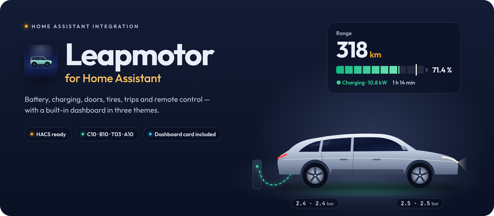
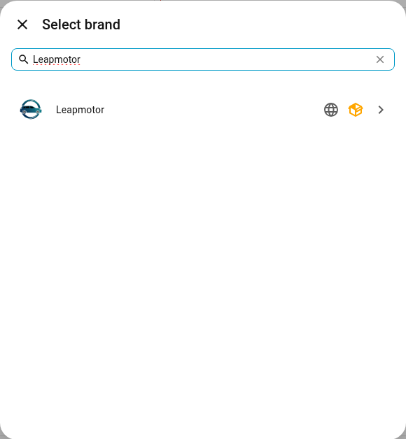
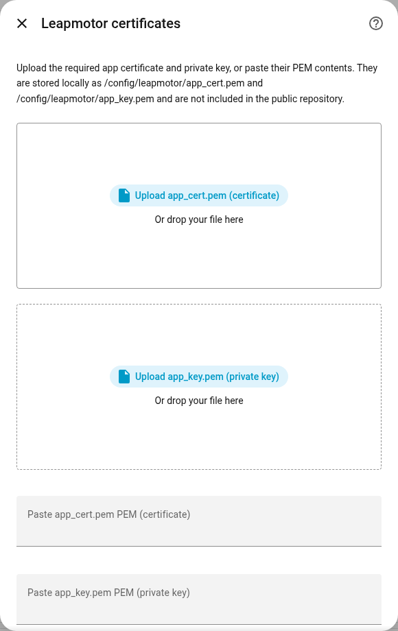
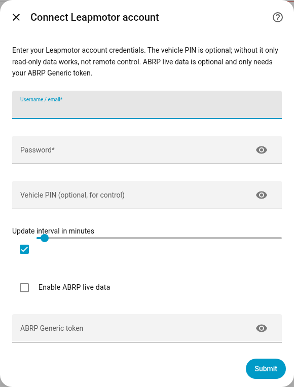

<p align="center">
  
</p>

# Installation guide (English)

This guide takes you through installing the **Leapmotor** integration in Home
Assistant, from the start to a working dashboard, and then covers every
setting, service and known limitation. For a short overview see
[README.md](../README.md). Slovenska navodila:
[navodila-sl.md](navodila-sl.md).

> [!IMPORTANT]
> This is an unofficial project, not affiliated with or endorsed by Leapmotor.
> Use it at your own risk. Leapmotor can change its API at any time, and
> remote-control actions should only be used deliberately and with the car in a
> safe state.

---

## What you need

| What | Notes |
| --- | --- |
| **Home Assistant 2025.3 or newer** | Older versions don't support the vehicle settings (config sub-entries). |
| **Leapmotor account e-mail and password** | Your login details. |
| **App certificate:** `app_cert.pem` and `app_key.pem` | Two files needed to log in to the EU server. They are not part of this repository; see [below](#about-app_certpem-and-app_keypem). |
| **Vehicle PIN** *(optional)* | Only needed for remote control (locking, climate …). Prefilled with the factory PIN `0000`. |

> [!TIP]
> Create a **second Leapmotor account**, share the car with it in the official
> app, and use that shared account in Home Assistant. Using the same account in
> both places can log the phone app out.

---

## About `app_cert.pem` and `app_key.pem`

Logging in to the Leapmotor EU server needs two files:

- **`app_cert.pem`**: the app certificate,
- **`app_key.pem`**: its private key.

They are **not** your username and password and not personal vehicle data;
they are app-level material. They are kept in the [`certs`](../certs) folder of
this repository. Setup offers **Download from GitHub**, which fetches both
files, checks that they belong together and stores them in
`/config/leapmotor/`. Later you find the same switch under **Settings → Devices
& services → Leapmotor → Configure**, and a missing pair shows up under
**Settings → Repairs** with a one-click download. Uploading or pasting your own
files still works.

The installed integration itself contains no certificate; the files are only
fetched when you ask for them.

---

## 1. Install the integration

### With HACS (recommended)

[](https://my.home-assistant.io/redirect/hacs_repository/?owner=Sabotin&repository=LeapBridge&category=integration)

1. Click the button above, or in HACS open **⋮ → Custom repositories** and add
   `https://github.com/Sabotin/LeapBridge` with the type **Integration**.
2. Search for **Leapmotor** in HACS and click **Download**.
3. **Restart** Home Assistant.

### Manually (step by step)

Use this if you don't use HACS. You need access to your Home Assistant
configuration folder (`/config`), for example with the **Samba share**,
**Studio Code Server**, **File editor** or **Terminal & SSH** add-on.

1. Download the repository as a ZIP:
   **[Sabotin/LeapBridge → main.zip](https://github.com/Sabotin/LeapBridge/archive/refs/heads/main.zip)**
   and unpack it on your computer.
2. Copy the folder `custom_components/leapmotor` from the unpacked ZIP into
   your Home Assistant config folder, so that this file exists:
   `/config/custom_components/leapmotor/manifest.json`.
   If `custom_components` doesn't exist yet, create it. Copy the **whole**
   `leapmotor` folder (including `frontend/` and `translations/`), not just its
   contents.
3. **Restart** Home Assistant: **Settings → System → ⏻ (top right) → Restart
   Home Assistant**.

<details>
<summary><b>Or do steps 1–2 in the Terminal &amp; SSH add-on</b></summary>

```bash
mkdir -p /config/custom_components
```
```bash
wget -O /tmp/leapmotor.zip https://github.com/Sabotin/LeapBridge/archive/refs/heads/main.zip
```
```bash
rm -rf /tmp/leapmotor-src && unzip -q /tmp/leapmotor.zip -d /tmp/leapmotor-src
```
```bash
rm -rf /config/custom_components/leapmotor && cp -r /tmp/leapmotor-src/*/custom_components/leapmotor /config/custom_components/
```
```bash
ls /config/custom_components/leapmotor/manifest.json
```

</details>

---

## 2. Choose your language

Click your name (bottom left) → **Language** → **English** or
**Slovenščina**. Entity names, the setup dialogs and the dashboard follow this
setting. Each user can also override the dashboard language in its
**Settings** tab.

---

## 3. (Optional) Certificates in advance

You can enter them during setup (step 4), or put them in this folder now:

```
/config/leapmotor/app_cert.pem
/config/leapmotor/app_key.pem
```

This folder is outside `custom_components`, so updates never delete your
certificates.

---

## 4. Set up the integration

1. **Settings → Devices & services → + Add integration → Leapmotor**.
2. **Certificates**: choose **Download from GitHub (recommended)**, or upload
   or paste `app_cert.pem` and `app_key.pem` yourself.
   (This step is skipped when the files are already in `/config/leapmotor/`.)
3. **Account**: e-mail, password, vehicle PIN (prefilled with `0000`) and the
   update interval.
4. Done. Your car appears as a device with all its entities. Each vehicle is
   listed below the account entry; open it to set its PIN, cabin presets,
   battery capacity, speed alert or ABRP token.

> [!NOTE]
> If setup stops at the certificates, the message tells you what is wrong:
> *the certificate is not valid PEM*, *the key is not valid*, or *the
> certificate and key don't match*. In that case check that you have the right
> pair of files from the same source.

<table>
  <tr>
    <td width="33%"><p align="center"><sub>Add integration</sub></p></td>
    <td width="33%"><p align="center"><sub>Certificates</sub></p></td>
    <td width="33%"><p align="center"><sub>Account</sub></p></td>
  </tr>
</table>

---

## 5. The dashboard

**Plug and play:** after setup, **Leapmotor** appears in the sidebar with the
full dashboard, one per vehicle. Hide it with *Show the Leapmotor dashboard in
the sidebar* in **Leapmotor → Configure**.

You can also put the card on any dashboard: **+ Add card** → search for
**Leapmotor** (or choose *Manual* and paste the line below).

```yaml
type: custom:leapmotor-card
```

If the card isn't found, refresh the browser once with **Ctrl + F5**
(⌘ + Shift + R on macOS). In the companion app use
*Settings → Companion app → Debugging → Reset frontend cache*.

The card has five pages with tabs at the top:

- **Overview**: the car with its battery and quick buttons, the outlook for
  the next day (plug in or not, usual departure, real range), the vehicle
  check, a timeline of the last 24 hours and remote control (*Climate*,
  *Doors & security* and *Charging controls*),
- **Trips**: details of the selected trip (map with replay, consumption,
  speed, cost, eco score), the trip log by day with CSV export, the last
  7 days and your frequent routes,
- **Charging**: charging with the charge limit and charging commands, the last
  24 hours, battery and consumption, the charging curve and the charging
  history,
- **Vehicle**: maintenance, tires, insights, the car software and messages,
- **Journey**: a year of driving on a calendar, totals and records, the
  comparison with a petrol car, a range lab and achievements.

Plus a **Settings** tab (gear) where each user picks the theme, day or night
and the language, saved for that user on every device. A dot on a tab means
there is something to look at on that page. The card always opens on
*Overview*; use `tabs: false` to get everything on one page.

Three themes: **Car app** (range, battery bar, round buttons, the default),
**Classic** (night or day sky) and **Driver display** (gauges around the car).
The car on the card is the official render of your model and colour from the
Leapmotor cloud (the same picture as `image.<model>_vehicle_picture`). It shows
open doors, trunk, windows and sunroof, low tires, unlocked, climate heating or
cooling, sentry, driving and charging. If the labels are on the wrong end of
the car, turn on *Mirror the car picture* in the card options.

All card options are in [card.md](card.md).

---

## Configuration

| Setting | Where | Notes |
| --- | --- | --- |
| E-mail & password | Setup | Required. Invalid credentials start re-authentication; **Reconfigure** lets you replace the password proactively. |
| Certificates | Setup / options | Required for the EU backend. Stored in `/config/leapmotor/`. |
| Vehicle PIN | Per vehicle | Prefilled with the factory PIN **0000**; change it if you set your own. Clear it to keep the car read-only. |
| Cabin presets | Per vehicle | Preheat (default 22 °C, fan 7, recirculation), pre-cool (default 18 °C, fan 7, recirculation, A/C on) and the outside temperature above which *auto* cools (default 20 °C). |
| Severe-use schedule | Per vehicle | Shorter maintenance intervals for C10 (severe use) and T03 (city use). |
| Update interval | Options | In **minutes**. Diagnostics show it in seconds (`60` → `3600`). Use `1` for one-minute polling. |
| Eco polling | Options | Slows polling while every car is clearly locked, parked and unplugged. Minimum `5` minutes. Never wakes the car. |
| Update interval while driving | Options | Default **1 minute** while a car is driving, so trip maps and the speed alert get enough points. Never slower than the update interval. |
| Speed alert | Per vehicle | The *Speeding* sensor turns on above this speed (km/h). `0` uses the speed limit set in the car, if it is switched on. |
| ABRP live data | Per vehicle | Optional. Needs only that car's ABRP *Generic* token, no API key. |
| Low tariff | Options | Optional home low-tariff price, start/end time (e.g. 22:00–06:00) and "all day on weekends" (two-rate tariffs). Home sessions are split by time between the two prices. |
| Charging tariffs | Options | Price per kWh for **home**, **public AC** and **public DC**. A session counts as home when it starts inside your Home zone; DC when the car reports a DC cable or charges above 22 kW. Leave 0 to skip costs. Prices apply to sessions from then on. |
| Battery capacity | Per vehicle | Optional usable capacity in kWh (e.g. 69.9). Used as 100 % for battery health; leave 0 to compare with the best capacity measured. |
| Comparison with a petrol car | Options | **Fuel price per litre**, the **consumption of a comparable petrol car** (default 6.5 l/100 km) and the **CO₂ of your electricity** (default 250 g/kWh; use about 30 for your own solar). Used for the fuel, money and CO₂ saved. Without a fuel price the litres and CO₂ are still shown. |

*Options* means **Settings → Devices & services → Leapmotor → Configure** (the
cog on the account). *Per vehicle* means the vehicle listed below the account →
**Configure**.

With several vehicles, entities are created per VIN and services accept either
`vin` or any Leapmotor `entity_id`. Existing single-vehicle settings migrate
automatically; on multi-vehicle accounts an old account-wide ABRP token is not
copied to every car, so set it on the intended vehicle.

<details>
<summary><b>Behaviour notes</b></summary>

- The backend is **polled**, not streamed. Values can lag behind the car; use
  the `Last refresh` sensor and diagnostic age attributes in automations.
- Entity IDs are stable English slugs (e.g. `sensor.c10_battery`). Display
  names follow your Home Assistant language.
- Unavailable entities from older versions are not removed automatically.
  Remove and re-add the integration for a clean set.
- GPS sign issues are corrected only when the mirrored coordinate is clearly
  closer to your Home Assistant home location.
- EV consumption is exposed as `kWh/100 km`, plus `mi/kWh` when the API
  provides it.
- **Trip log and charging sessions** are worked out from the polled data, so
  their precision follows the update interval: set it to **1 minute** for
  exact start and end times and to catch short trips. Trips and sessions are
  stored locally in Home Assistant and survive restarts.
  Regenerated energy is not estimated; polling is too coarse for regen bursts.
- **Trip map** draws the route from the location history Home Assistant
  already records for the car's device tracker (and the speed sensor for the
  colours: blue below the limit, orange near it, red above it); the
  integration stores no extra location data. Points come once per update, so
  the line connects them straight. If Home Assistant's map cannot load, the
  card draws the route without a background map.
- **Speeding** is checked once per update, so it catches sustained speeding,
  not short bursts. Setting the car's own speed limit from Home Assistant is
  not supported (no verified command).
- **Charge limit on the T03** is sent like LeapConnect does (leapmotor-api
  0.6.0): command 190 built from the cloud's charging schedule, range
  50–100 % in steps of 5. If the car does not confirm it, it is sent once
  more; the same value twice is harmless. Switching the T03 charging schedule
  on or off stays unsupported.
- **Battery health** needs at least three days with a full (100 %) charge.
- **What the integration learns** comes only from the trips and charging
  sessions it has recorded in your Home Assistant; nothing is sent anywhere.
  The **predicted departure** looks at the last eight weeks: a weekday gets a
  usual departure when the car left within the same 45 minutes on at least
  three of those days and on at least half of them. Until then the sensors
  stay *unknown* rather than guess.
- **The outlook** (*Expected distance next day*, *Battery needed next day*,
  *Enough for next day*) is about tomorrow; between midnight and 04:00 it is
  about the day that has just begun, so a late evening still gets the right
  answer.
- **Charge recommended** turns on when the battery is below what the next
  day's usual distance needs plus a 15 % reserve, or below 15 %, and stays
  off while the car is plugged in.
- **Real range** uses your own consumption at the current outside temperature
  when there are enough trips in that range, otherwise your recent trips,
  otherwise the cloud's six-week average. The attribute `basis` says which.
- **Eco score** compares each trip with your own usual consumption on similar
  trips (three quarters of the score) and adds a part for speed. It is a
  comparison with yourself, not with other drivers.
- **Slow charging** compares the AC power of the session in progress with
  your earlier sessions at the same kind of place (home, public AC). It turns
  on when the power stays below 70 % of your usual after ten minutes and
  below 85 % battery. It needs three earlier sessions and never judges DC
  charging, where power falls with the battery level anyway.
- **Charging interrupted** is reported when charging stops clearly below the
  charge limit while the cable stays in. On the T03, where the limit cannot be
  read reliably, it is not reported.
- **Car software, messages, schedules, charging history** are read from the
  Leapmotor cloud less often than the car status (software every 6 hours,
  charging history hourly, schedules every 30 minutes) and keep their last
  value when a read fails. `leapmotor.refresh_cloud_data` reads them now.
  The software information is only available to the owner's account.
- **A year of driving** is read back from the cloud a quarter at a time, one
  step per update, so the calendar is complete after the first few updates.
- **Trip comparison** keeps approximate trip start and end points (rounded to
  about 100 m) in Home Assistant's local storage, only to find similar trips.
  They are never exposed in attributes or diagnostics.
- **Tire warnings** flag a tire below 1.9 bar, 0.3 bar below the others, or
  falling 0.2 bar faster than the others against its 7-day median, so a cold
  morning does not trigger it but a slow leak does.
- **Maintenance** loads the factory schedule for your model (T03, B10, C10,
  C10 REEV, plus common items). Until you log a service, it assumes services
  were done on schedule.
- **Last 7 days** covers today and the six previous calendar days in your
  Home Assistant time zone. `energy_complete` validates field and mileage
  coverage only, not physical accuracy. The original cloud day label stays in
  `daily_detail.source_date`.
- **B10:** daily `accumulatedEnergyConsume` is demonstrably unreliable (#67),
  so B10 daily `energy_kwh`, `driving_energy_kwh` and the rolling total stay
  unknown with `energy_unavailable_reason: unreliable_source`. Raw values,
  dates, mileage and coverage remain available; no scaling is applied.
- **T03:** daily energy is reported in Wh and converted to kWh
  (`daily_detail.energy_raw` keeps the source value). Charging-schedule writes
  are not supported; use the car or the official app. Read-only charge-limit
  values can be stale (`reliability: unverified`). Wallbox pauses with the
  observed idle signal are reported as connected (`plugged_in`, EVCC `B`);
  signal 1197 alone cannot identify DC on T03. Standing in Park with about
  1 kW or more flowing into the battery counts as charging, whatever the
  charge-state code or the READY flag report.
- **A10:** steering-wheel heating levels 1/2 and remote mode 3 are detected;
  unknown A10 modes stay unknown.
- Battery preheating is a stateful **switch**, so it can be turned on and off.
- The charging-schedule switch enables/disables the existing schedule while
  preserving its start, end, recurrence and charge limit.

</details>

---

## Services

All services live under `leapmotor.*` and accept `vin` or a Leapmotor
`entity_id`. Services that physically control the car require the vehicle PIN;
availability also depends on the model, the car's state and shared-car
permissions.

| Service | PIN | Purpose |
| --- | :---: | --- |
| `leapmotor.lock` / `leapmotor.unlock` | 🔒 | Lock or unlock |
| `leapmotor.unlock_charger` | 🔒 | Release the charging connector before unplugging |
| `leapmotor.trunk_open` / `leapmotor.trunk_close` | 🔒 | Open or close the trunk |
| `leapmotor.find_car` | 🔒 | Flash and honk |
| `leapmotor.windows_open` / `leapmotor.windows_close` | 🔒 | Windows, optional `value` 0–100 |
| `leapmotor.sunshade_open` / `leapmotor.sunshade_close` | 🔒 | Sunshade, optional `value` 0–10 |
| `leapmotor.ac_off` | 🔒 | Climate off |
| `leapmotor.set_climate` | 🔒 | `mode` (`cold`, `hot`, `wind`, `nohotcold`), `temperature` 18–32, `fan_speed` 1–7, `recirculate`, `windshield_defrost` |
| `leapmotor.set_climate_schedule` / `leapmotor.cancel_climate_schedule` | 🔒 | Pre-conditioning schedule |
| `leapmotor.prepare_car` | 🔒 | One-touch preparation: climate, seats, steering wheel, mirrors, optional navigation |
| `leapmotor.set_prepare_car_schedule` / `leapmotor.cancel_prepare_car_schedule` | 🔒 | Scheduled preparation |
| `leapmotor.quick_cool` / `leapmotor.quick_heat` | 🔒 | Climate quick profiles |
| `leapmotor.windshield_defrost` | 🔒 | Windshield defrost |
| `leapmotor.set_charge_limit` | 🔒 | `charge_limit_percent` |
| `leapmotor.preheat_cabin` | 🔒 | Heat with the vehicle preset; optional `temperature`, `fan_speed`, `recirculate` |
| `leapmotor.precool_cabin` | 🔒 | Cool with A/C using the vehicle preset; same optional fields |
| `leapmotor.precondition_cabin` | 🔒 | Cool when warm outside, otherwise heat |
| `leapmotor.charging_start` / `leapmotor.charging_stop` | 🔒 | Start or stop charging while plugged in |
| `leapmotor.sunroof_open` / `leapmotor.sunroof_close` | 🔒 | Sunroof, on cars that report one |
| `leapmotor.log_maintenance` | no | `service_type`, optional `odometer_km`, `date` |
| `leapmotor.reset_maintenance` | no | Forget a logged service |
| `leapmotor.send_destination` | no | `name`, `latitude`, `longitude`, optional `address` |
| `leapmotor.export_diagnostics` | no | Write a redacted support JSON |
| `leapmotor.get_trips` | no | Returns the stored trip log as response data (optional `limit`, up to 500) |
| `leapmotor.get_charging_sessions` | no | Returns the recorded charging sessions and the ones the cloud keeps (optional `limit`) |
| `leapmotor.refresh_cloud_data` | no | Read software, schedules, charging history and share invitations again now |
| `leapmotor.accept_share_invitation` / `leapmotor.decline_share_invitation` | no | Answer a car-share invitation waiting for this account; optional `vin_tail` when several are waiting |

Sentry mode and healthy charging are switches. The commands for sentry mode,
start/stop charging, healthy charging and the sunroof come from LeapConnect and
use the same verified remote-control flow; they have not yet been confirmed on
every model.

`set_climate_schedule` and `set_prepare_car_schedule` replace all existing
schedules with one entry. `start_time` must be in the future in the car's local
time; `days` uses `0 = Sunday` … `6 = Saturday`, an empty list means once.

<details>
<summary><b>Examples</b></summary>

Heat the cabin to 26 °C:

```yaml
action: leapmotor.set_climate
data:
  entity_id: sensor.c10_battery
  mode: hot
  temperature: 26
  fan_speed: 4
  recirculate: true
```

Pre-condition on Monday morning:

```yaml
action: leapmotor.set_climate_schedule
data:
  entity_id: sensor.c10_battery
  start_time: "2026-06-09 07:30:00"
  mode: hot
  temperature: 26
  fan_speed: 4
  days: [1]
```

Prepare the car now with cooling and seat ventilation:

```yaml
action: leapmotor.prepare_car
data:
  entity_id: sensor.c10_battery
  mode: cold
  temperature: 18
  fan_speed: 7
  recirculate: true
  driver_seat: ventilation
  driver_seat_level: 3
  passenger_seat: ventilation
  passenger_seat_level: 3
```

Release the charging connector:

```yaml
action: leapmotor.unlock_charger
data:
  entity_id: sensor.c10_battery
```

Disable the charging schedule:

```yaml
action: switch.turn_off
target:
  entity_id: switch.c10_charging_schedule
```

Save the trip log to a file every night (a driver's logbook):

```yaml
triggers:
  - trigger: time
    at: "23:55:00"
actions:
  - action: leapmotor.get_trips
    data:
      entity_id: sensor.c10_battery
      limit: 50
    response_variable: log
  - action: notify.send_message
    target:
      entity_id: notify.trip_log_file
    data:
      message: "{{ log.trips | to_json }}"
```

React to something the car did:

```yaml
triggers:
  - trigger: state
    entity_id: event.c10_activity
conditions:
  - condition: template
    value_template: "{{ trigger.to_state.attributes.event_type == 'trip_finished' }}"
actions:
  - action: notify.mobile_app_phone
    data:
      message: >-
        {{ trigger.to_state.attributes.distance_km }} km,
        eco score {{ trigger.to_state.attributes.eco_score }}
```

Send a destination:

```yaml
action: leapmotor.send_destination
data:
  entity_id: device_tracker.c10_location
  name: Ljubljana Center
  address: Prešernov trg, Ljubljana
  latitude: 46.05139
  longitude: 14.50611
```

</details>

---

## ABRP and EVCC

**ABRP** telemetry is optional and off by default. Open the vehicle below the
Leapmotor account entry, enable *ABRP live data* and paste that car's ABRP
Generic token. Tokens are VIN-scoped, so one car's data never reaches another
car's token.

**EVCC** can read everything it needs from Home Assistant: SOC, range, plug
state, charging, `evcc_status`, charging power/current/voltage, odometer and
`charging_finish_time`.

---

## Troubleshooting

| Problem | Fix |
| --- | --- |
| HACS can't install | Add the repository as type **Integration**, then restart. |
| Certificate or login errors | Upload/paste both PEM files, or place them as `/config/leapmotor/app_cert.pem` and `app_key.pem`. |
| *Certificate and key don't match* | The files are not a pair from the same source; get a matching pair. |
| Login `code 21` / wrong account or password | If the same credentials work in the app: log out fully, change/reset the password once in the official app, retry. |
| Phone app keeps logging out | Use a second account with shared vehicle access. |
| Stale or wrong values | Press **Refresh data**, check **Last refresh**, then run `leapmotor.export_diagnostics`. |
| Remote control does nothing | Configure the vehicle PIN; check account and shared-car permissions. |
| *Token is invalid* / *Leapmotor rejected the session* | The integration logs in again and retries on its own. If it keeps happening, the official app is probably signed in with the same account; use a second account with the car shared to it. |
| *Leapmotor accepted the command but did not confirm the result* | The command most likely reached the car. Wait a few seconds and check its state before sending it again. |
| Card not found | Hard-refresh the browser (Ctrl + F5) or reset the companion-app frontend cache. |
| No tabs or no Settings tab on a tablet or phone | The app is still running an older copy of the dashboard. In the companion app: *Settings → Companion app → Debugging → Reset frontend cache*, then reopen it. In a browser: Ctrl + F5. |

<details>
<summary><b>Debug logging</b></summary>

```yaml
logger:
  default: info
  logs:
    custom_components.leapmotor: debug
```

Restart after editing `configuration.yaml`. Logs show sanitised API status
codes, polling-mode changes and flow details. Check logs for account data,
VINs, locations, tokens and certificate material before sharing them; for
public issues prefer `leapmotor.export_diagnostics`.

</details>

<details>
<summary><b>China / Rest of the World beta (upstream 0.8.0b4)</b></summary>

The upstream project publishes an experimental
[EU/CN beta 0.8.0b4](https://github.com/kerniger/leapmotor-ha/releases/tag/v0.8.0b4)
that adds **China / Rest of the World** to the setup. 0.7.5, the version this
repository is based on, is the stable release; CN support there is
experimental and read-only (telemetry, binary sensors, manual refresh,
phone/SMS or session import, optional per-entry proxy). Controls, lock status,
windows, climate, navigation, location, history, ABRP, EVCC and vehicle images
are not available for CN yet. See the upstream
[CN guide](https://github.com/kerniger/leapmotor-ha/blob/v0.8.0b4/docs/cn/README.md).

</details>

---

## Updating

- **HACS:** HACS installs the latest release (the first one is 0.7.5). A new
  release appears in HACS and among the updates in Home Assistant's settings:
  download it and restart. If you do not see it yet, open Leapmotor in HACS →
  **⋮ → Update information**. If you installed before the first release,
  choose **Redownload** once. If the card still looks old, refresh the browser
  (**Ctrl + F5**).
- **Manually:** repeat [step 1](#manually-step-by-step) (replace the folder)
  and restart. Your certificates in `/config/leapmotor/` stay untouched.

Full history in [CHANGELOG.md](../CHANGELOG.md).

---

## Acknowledgements

- The integration is based on **[leapmotor-ha](https://github.com/kerniger/leapmotor-ha)**
  by [kerniger](https://github.com/kerniger) (MIT). All the hard
  reverse-engineering work is theirs; this repository adds the redesign, the
  dashboard card and the Slovenian translation.
- The trip log, charging sessions, time-of-use pricing, trip comparison,
  battery-health estimate and maintenance engine are ported from
  **[LeapConnect](https://github.com/markoceri/leapconnect)** by
  [Marco Mancino](https://github.com/markoceri) (AGPL-3.0); the extra remote
  commands come from his [leapmotor-api](https://pypi.org/project/leapmotor-api/)
  and the maintenance schedules from his
  [maintenance packs](https://github.com/markoceri/leapconnect-maintenance-packs) (MIT).
- [sbstn-0x2a](https://github.com/sbstn-0x2a): raw-signal mappings for
  charging, doors, climate, heating, seating, range and diagnostics.
- [markoceri](https://github.com/markoceri): public Leapmotor API and
  certificate research.
- [Mikado8231](https://github.com/Mikado8231): A10 heating fix and HA test matrix.
- Looking for trip logs and charge history with its own web UI? Try
  [leapmotor-mate](https://github.com/ProtossBlaster/leapmotor-mate).
- Fonts: [Outfit](https://github.com/Outfitio/Outfit-Fonts) and
  [JetBrains Mono](https://github.com/JetBrains/JetBrainsMono), SIL Open Font License 1.1.

---

## Legal

Read [LEGAL.md](../LEGAL.md) and [SECURITY.md](../SECURITY.md) before
publishing logs, diagnostics or modified builds. Never post certificates,
tokens, VINs or precise locations.

**GNU AGPL-3.0**: see [LICENSE](../LICENSE). Third-party notices, including
the original MIT licence of leapmotor-ha, are in [NOTICE.md](../NOTICE.md).

<p align="center"><sub>Made for Leapmotor drivers · not affiliated with Leapmotor</sub></p>
