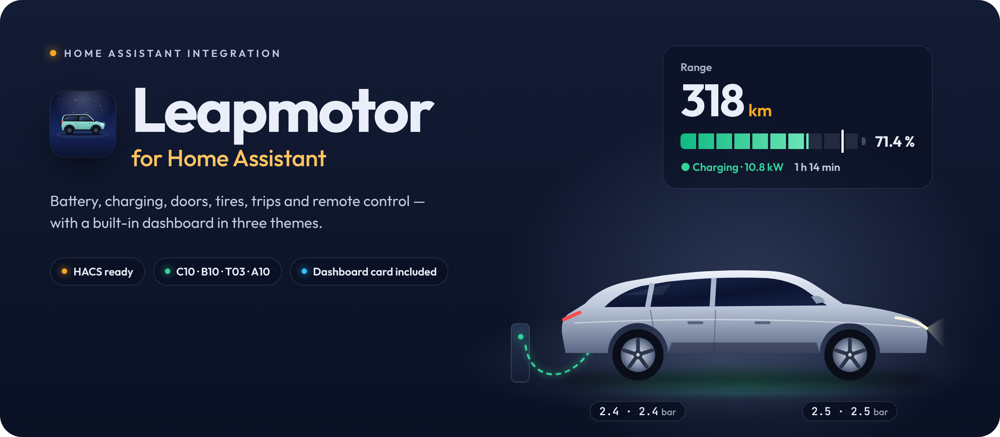

<p align="center">
  
</p>

# Navodila za namestitev (slovensko)

Ta vodnik te pelje skozi namestitev integracije **Leapmotor** v Home Assistant,
od začetka do delujoče nadzorne plošče. Za angleška navodila glej
[guide-en.md](guide-en.md).

> [!IMPORTANT]
> To je neuradna integracija, ni povezana z družbo Leapmotor. Uporaba na lastno
> odgovornost. Leapmotor lahko kadar koli spremeni svoj API; ukaze za daljinsko
> upravljanje uporabljaj premišljeno in le, kadar je vozilo v varnem stanju.

---

## Kaj potrebuješ

| Kaj | Opomba |
| --- | --- |
| **Home Assistant 2025.3 ali novejši** | Starejše različice ne podpirajo nastavitev vozila. |
| **E-pošta in geslo računa Leapmotor** | Tvoji podatki za prijavo. |
| **Certifikat aplikacije:** `app_cert.pem` in `app_key.pem` | Dve datoteki, potrebni za prijavo na evropski strežnik. Namestitev ju prenese sama, glej [spodaj](#o-certifikatu-app_certpem-in-app_keypem). |
| **PIN vozila** *(neobvezno)* | Potreben samo za daljinsko upravljanje (zaklepanje, klima …). |

> [!TIP]
> Priporočilo: ustvari **drugi račun Leapmotor** in mu v uradni aplikaciji deli
> vozilo. Ta deljeni račun nato uporabi v Home Assistantu. Če uporabiš isti
> račun v aplikaciji in v Home Assistantu, te lahko aplikacija odjavi.

---

## O certifikatu `app_cert.pem` in `app_key.pem`

Za prijavo na evropski strežnik Leapmotor sta potrebni dve datoteki:

- **`app_cert.pem`:** certifikat aplikacije,
- **`app_key.pem`:** pripadajoči zasebni ključ.

To **nista** tvoje uporabniško ime in geslo in nista osebna podatka vozila, ampak sta
gradivo na ravni aplikacije. Shranjeni sta v mapi [`certs`](../certs) tega
repozitorija. Namestitev ponudi **Prenesi z GitHuba**: obe datoteki prenese,
preveri, ali sodita skupaj, in ju shrani v `/config/leapmotor/`. Isto stikalo
najdeš pozneje pod **Nastavitve → Naprave in storitve → Leapmotor →
Konfiguriraj**, manjkajoč par pa se pokaže pod **Nastavitve → Popravila**, kjer
ga preneseš z enim klikom. Še vedno lahko naložiš ali prilepiš tudi svoji
datoteki.

Nameščena integracija sama ne vsebuje certifikata; datoteki se preneseta šele,
ko to zahtevaš.

---

## 1. Namestitev integracije

### Prek HACS (priporočeno)

1. V HACS odpri **⋮ → Poljubni repozitoriji** (*Custom repositories*).
2. Dodaj `https://github.com/Sabotin/LeapBridge`, vrsta **Integration**.
3. Poišči **Leapmotor** in klikni **Prenesi** (*Download*).
4. **Znova zaženi** Home Assistant.

### Ročno

1. Prenesi ZIP: **[Sabotin/LeapBridge → main.zip](https://github.com/Sabotin/LeapBridge/archive/refs/heads/main.zip)** in ga razpakiraj.
2. Mapo `custom_components/leapmotor` kopiraj v svoj Home Assistant, tako da
   obstaja datoteka `/config/custom_components/leapmotor/manifest.json`.
   Kopiraj **celotno** mapo `leapmotor` (vključno z `frontend/` in
   `translations/`).
3. **Znova zaženi** Home Assistant.

<details>
<summary><b>Ročno prek dodatka Terminal &amp; SSH</b></summary>

```bash
mkdir -p /config/custom_components
```
```bash
wget -O /tmp/leapmotor.zip https://github.com/Sabotin/LeapBridge/archive/refs/heads/main.zip
```
```bash
rm -rf /tmp/leapmotor-src && unzip -q /tmp/leapmotor.zip -d /tmp/leapmotor-src
```
```bash
rm -rf /config/custom_components/leapmotor && cp -r /tmp/leapmotor-src/*/custom_components/leapmotor /config/custom_components/
```
```bash
ls /config/custom_components/leapmotor/manifest.json
```

</details>

---

## 2. Izbira jezika

Klikni svoje ime (spodaj levo) → **Jezik** (*Language*) → **Slovenščina**.
Imena entitet, pogovorna okna za namestitev in nadzorna plošča se ravnajo po tej
nastavitvi. Na voljo sta slovenščina in angleščina.

---

## 3. (Neobvezno) Certifikati vnaprej

Lahko ju vneseš med namestitvijo (korak 4) ali pa ju že zdaj shraniš v mapo:

```
/config/leapmotor/app_cert.pem
/config/leapmotor/app_key.pem
```

Ta mapa je zunaj `custom_components`, zato je posodobitve nikoli ne izbrišejo.

---

## 4. Nastavitev integracije

1. **Nastavitve → Naprave in storitve → + Dodaj integracijo → Leapmotor**.
2. **Certifikati:** izberi **Prenesi z GitHuba (priporočeno)** ali sam naloži
   oziroma prilepi `app_cert.pem` in `app_key.pem`.
   (Ta korak se preskoči, če sta datoteki že v `/config/leapmotor/`.)
3. **Račun:** e-pošta, geslo, neobvezni PIN vozila in interval posodabljanja.
4. Končano. Vozilo se pojavi kot naprava z vsemi entitetami.

> [!NOTE]
> Če se namestitev ustavi pri certifikatih, ti sporočilo pove, kaj je narobe:
> *certifikat ni veljaven PEM*, *ključ ni veljaven*, ali *certifikat in ključ se
> ne ujemata*. V tem primeru preveri, da imaš pravi par datotek iz istega vira.

---

## 5. Nadzorna plošča

**Plug & play:** po namestitvi se v stranski vrstici sama pojavi **Leapmotor** s
celotno nadzorno ploščo (za vsako vozilo svoja). Skriješ jo v *Leapmotor →
Nastavi* s stikalom *Prikaži nadzorno ploščo v stranski vrstici*.

Kartico lahko dodaš tudi na svojo nadzorno ploščo: **+ Dodaj kartico** →
poišči **Leapmotor** (ali *Ročno* in prilepi spodnje).

```yaml
type: custom:leapmotor-card
```

Če kartice ne najde, enkrat osveži brskalnik s **Ctrl + F5**
(⌘ + Shift + R na macOS). V aplikaciji: *Nastavitve → Aplikacija → Razhroščevanje
→ Ponastavi predpomnilnik vmesnika*.

Kartica ima pet strani z zavihki na vrhu:

- **Pregled:** avto z baterijo in hitrimi gumbi, napoved za naslednji dan
  (priključiti ali ne, običajni odhod, dejanski doseg), pregled vozila,
  časovnica zadnjih 24 ur in daljinsko upravljanje (*Klima* ter *Vrata in
  varnost*),
- **Vožnje:** podrobnosti izbrane vožnje (zemljevid s predvajanjem, poraba,
  hitrost, strošek, eko ocena), dnevnik voženj po dnevih z izvozom v CSV,
  zadnjih 7 dni in pogoste poti,
- **Polnjenje:** polnjenje z mejo polnjenja in ukazi za polnjenje, zadnjih
  24 ur, baterija in poraba, polnilna krivulja in zgodovina polnjenj,
- **Vozilo:** vzdrževanje, pnevmatike, vpogledi, programska oprema avta in
  sporočila,
- **Pot:** leto voženj na koledarju, seštevki in rekordi, primerjava z
  bencinskim avtom, laboratorij dosega in dosežki.

Pika na zavihku pove, da je na tisti strani nekaj za pogledati. Kartica se
vedno odpre na *Pregledu*; vse na eni strani dobiš s `tabs: false`.

Vse možnosti kartice so v [docs/card.md](card.md).

---

## PIN vozila

PIN je že vnaprej izpolnjen s tovarniškim **0000**. Če si ga v vozilu
spremenil, ga popravi pri namestitvi ali pozneje v nastavitvah vozila (pod
računom). Če polje izbrišeš, ostane vozilo samo za branje.

## Predgretje in hlajenje kabine

V nadzorni plošči in kot gumbi v Home Assistantu:

- **Predgrej kabino:** privzeto 22 °C, ventilator 7, samo kroženje zraka.
- **Ohladi kabino:** klima, najnižja temperatura 18 °C, ventilator 7.
- **Pripravi kabino (samodejno):** hladi, ko je zunaj topleje od nastavljene
  meje (privzeto 20 °C), sicer greje.

Temperature, moč ventilatorja, kroženje in mejo za samodejni način nastaviš pri
vozilu (*Nastavitve → Naprave in storitve → Leapmotor →* vozilo pod računom →
*Nastavi*). Za vsakodnevno uporabo uvozi načrt **Pre-condition before
departure** (glej README) in izberi uro in dneve, ali pa načrt **Pre-condition
before your usual departure**, ki se ure nauči iz tvojih voženj.

## Vzdrževanje

Servisni načrt za tvoj model (T03, B10, C10, C10 REEV) se naloži samodejno.
Dokler servisa ne zabeležiš, se predpostavi, da je bil opravljen redno. Po
servisu v nadzorni plošči pri postavki dvakrat tapni **Opravljeno**.

## Stroški polnjenja in zdravje baterije

- **Cene polnjenja:** *Nastavitve → Naprave in storitve → Leapmotor → Nastavi*
  (zobnik pri računu). Vnesi ceno na kWh za polnjenje **doma**, **javno AC** in
  **javno DC**. Polnjenje šteje kot domače, če se začne v coni *Doma*; kot DC,
  če vozilo javi kabel DC ali polni z več kot 22 kW. Pusti 0, če stroškov ne
  želiš spremljati.
- **Nizka tarifa (MT):** v istih nastavitvah vpiši ceno nizke tarife, uro
  začetka in konca (npr. 22:00–06:00) in po želji *ves dan ob vikendih*.
  Polnjenje doma se po času razdeli med nizko in visoko tarifo.
- **Kapaciteta baterije:** pri posameznem vozilu (pod računom) lahko vpišeš
  uporabno kapaciteto nove baterije v kWh. Pusti 0 za primerjavo z najboljšo
  doslej izmerjeno vrednostjo. Ocena zdravja se pokaže po treh dneh s polnim
  (100 %) polnjenjem.
- **Dnevnik voženj:** vožnje in polnjenja se zaznajo samodejno iz podatkov
  vozila. Med vožnjo integracija privzeto poizveduje **vsako minuto**
  (*Interval posodabljanja med vožnjo* v nastavitvah računa).

## Kaj se integracija nauči iz tvojih voženj

Vse spodaj se izračuna v tvojem Home Assistantu iz voženj in polnjenj, ki jih
je integracija zabeležila. Nič se ne pošilja nikamor. Dokler podatkov ni
dovolj, senzorji ostanejo *neznani* in ne ugibajo.

- **Naslednji predvideni odhod:** iz zadnjih osmih tednov voženj integracija
  ugotovi, kdaj se z avtom običajno odpelješ na posamezen dan v tednu. Dan
  dobi običajni odhod, ko si se vsaj trikrat in vsaj ob polovici takih dni
  odpeljal v istih 45 minutah.
- **Napoved za naslednji dan:** *Pričakovana razdalja naslednji dan*,
  *Potrebna baterija naslednji dan*, *Dovolj za naslednji dan* in *Priporočeno
  polnjenje*. Polnjenje se priporoči, ko je baterije manj, kot je potrebuje
  običajna razdalja naslednjega dne s 15 % rezerve, ali manj kot 15 %. Ko je
  avto priključen, priporočila ni.
- **Dejanski doseg:** doseg iz tvoje porabe pri trenutni zunanji temperaturi,
  ob podatku iz avta, in *Doseg pri meji polnjenja*.
- **Eko ocena:** vsaka vožnja dobi oceno od 0 do 100 glede na tvojo običajno
  porabo na podobnih vožnjah in glede na hitrost. Primerja te s teboj, ne z
  drugimi vozniki.
- **Pogoste poti:** poti, ki jih voziš največkrat (Doma → Služba), z običajnim
  časom, razdaljo, porabo, stroškom in najboljšo vožnjo. Imena so tvoje cone
  v Home Assistantu.
- **Napoved baterije:** trend kapacitete na leto iz polnih polnjenj in
  pričakovano *Zdravje baterije čez eno leto*.
- **Prihranek v primerjavi z bencinskim avtom:** prihranjen denar, gorivo in
  CO₂, ta mesec in skupaj. V *Leapmotor → Nastavi* vpiši **ceno goriva na
  liter**, **porabo primerljivega avta** (privzeto 6,5 l/100 km) in **CO₂
  tvoje elektrike** (privzeto 250 g/kWh; za lastno sončno elektrarno približno
  30). Brez cene goriva se litri in CO₂ vseeno prikažejo.
- **Polnilna krivulja in počasno polnjenje:** moč polnjenja glede na stanje
  baterije. Senzor *Počasno polnjenje* se vklopi, ko AC polnjenje po desetih
  minutah ostane pod 70 % moči, ki jo na takem mestu običajno dobiš, na
  primer, ko polnilnica preklopi na eno fazo. Potrebuje tri prejšnja
  polnjenja; DC polnjenj ne ocenjuje.
- **Pot in dosežki:** prevoženo letos, zaporedni dnevi vožnje, najdaljša
  vožnja in dan, povprečna poraba od začetka, delež polnjenja doma in enajst
  dosežkov v bronu, srebru in zlatu.
- **Dogodki:** entiteta *Dejavnost* (`event.<model>_activity`) se sproži ob
  začetku in koncu vožnje, začetku, koncu in prekinitvi polnjenja, priklopu in
  odklopu kabla, skoraj prazni bateriji, novem sporočilu, novi programski
  opremi in doseženem dosežku. Za obvestila na telefon uvozi načrt **Notify
  when something happens with the car** (glej README).

## Programska oprema, sporočila, zgodovina polnjenj in deljen avto

Ti podatki se berejo iz Leapmotorjevega oblaka redkeje kot stanje vozila
(programska oprema vsakih 6 ur, zgodovina polnjenj vsako uro, urniki vsakih
30 minut). Če branje ne uspe, ostane zadnja vrednost. Dejanje
`leapmotor.refresh_cloud_data` jih prebere takoj.

- **Programska oprema vozila:** nameščena različica in entiteta
  *Programska oprema vozila*, ki pokaže, ko Leapmotor ponudi novo različico,
  z opisom novosti. Namestitev še vedno opraviš v avtu. Na voljo samo
  lastnikovemu računu; deljeni račun tega podatka ne sme brati.
- **Sporočila:** zadnjih 20 sporočil iz aplikacije Leapmotor, na kartici in v
  atributu `messages` senzorja *Neprebrana sporočila*.
- **Zgodovina polnjenj:** polnjenja zadnjih 60 dni iz oblaka z energijo,
  trajanjem, povprečno močjo, krajem in stroškom po tvojih cenah.
- **Leto voženj:** razdalja in energija po dnevih za do eno leto nazaj, za
  koledar na strani *Pot*. Prebere se postopoma, v prvih nekaj posodobitvah.
- **Urniki in dovoljenja:** *Naslednja načrtovana priprava kabine* pokaže,
  kdaj se bo sprožil urnik, nastavljen v avtu. *Dovoljenja za daljinsko
  upravljanje* povedo, kaj sme račun početi z avtom, kar je uporabno pri deljenem
  računu, kjer manjkajoče dovoljenje pojasni zavrnjen ukaz.
- **Deljen avto:** če je bil avto deljen z računom in povabilo še ni
  sprejeto, ti ga namestitev ponudi v sprejem, namesto da se konča brez
  vozila. Poznejša povabila se pokažejo v *Nastavitve → Popravila*. Brez
  tvoje potrditve se nič ne sprejme.
- **Izvoz:** `leapmotor.get_trips` in `leapmotor.get_charging_sessions` vrneta
  shranjeni dnevnik (do 500 vnosov). Na strani *Vožnje* gumb **CSV** prenese
  dnevnik voženj za preglednico ali knjigo voženj.

## Zemljevid vožnje, hitrost in meja polnjenja

- **Zemljevid vožnje:** na strani *Vožnje* tapni vožnjo v dnevniku in v
  *Podrobnostih vožnje* se pokaže njena pot, obarvana po hitrosti (modro pod omejitvijo, oranžno blizu nje, rdeče
  nad njo). Pot se nariše iz zgodovine lokacije, ki jo Home Assistant že
  shranjuje; integracija ne shranjuje dodatnih lokacij.
- **Opozorilo na hitrost:** pri vozilu (pod računom → *Nastavi*) vpiši
  *Opozorilo na hitrost* v km/h. Senzor **Prehitra vožnja** se vklopi nad to
  hitrostjo. Pri 0 velja omejitev hitrosti, nastavljena v avtu (če je
  vklopljena). Obvestilo na telefon: načrt **Speeding alert** (glej README).
  Hitrost se preveri ob vsaki posodobitvi, zato ujame daljšo prehitro vožnjo,
  ne kratkih sunkov.
- **Meja polnjenja:** v nadzorni plošči pri polnjenju s tipkama − in +
  izbereš vrednost (na T03 od 50 do 100 % po 5 %) in jo pošlješ z dvojnim
  tapom na **Nastavi**, ali z entiteto *Meja polnjenja*. Na T03 se
  pošlje tako kot v LeapConnectu; če avto ukaza ne potrdi, se pošlje še enkrat.
- **Živa slika avta:** avto na nadzorni plošči pokaže odprta vrata,
  prtljažnik in okna, nizek tlak v pnevmatikah, odklenjen avto, gretje ali
  hlajenje, stražo, vožnjo in polnjenje. Če oznake stojijo na napačnem koncu
  avta, v nastavitvah kartice vklopi *Mirror the car picture*.

---

## Odpravljanje težav

| Težava | Rešitev |
| --- | --- |
| HACS ne namesti | Repozitorij dodaj kot vrsto **Integration**, nato znova zaženi. |
| Napaka certifikata ali prijave | V možnostih integracije vklopi **Prenesi certifikata aplikacije z GitHuba**, naloži/prilepi obe datoteki PEM ali ju shrani kot `/config/leapmotor/app_cert.pem` in `app_key.pem`. |
| *Certifikat in ključ se ne ujemata* | Datoteki nista par iz istega vira. Prenesi par z GitHuba (možnosti integracije) ali priskrbi ujemajoč se par. |
| Prijava `code 21` / napačen račun ali geslo | Če isti podatki delujejo v uradni aplikaciji: popolnoma se odjavi, enkrat spremeni/ponastavi geslo v aplikaciji in poskusi znova. |
| Aplikacija te odjavlja | Uporabi drugi račun z deljenim vozilom. |
| Zastarele ali napačne vrednosti | Pritisni **Osveži podatke**, preveri **Zadnja osvežitev**, nato zaženi `leapmotor.export_diagnostics`. |
| Daljinsko upravljanje ne deluje | Nastavi PIN vozila; preveri dovoljenja računa in deljenega vozila. |
| *Token is invalid* ali *Leapmotor je zavrnil prijavo* | Integracija se sama znova prijavi in ukaz ponovi. Če se napaka ponavlja, si najbrž v uradni aplikaciji prijavljen z istim računom. Uporabi drugi račun z deljenim vozilom. |
| *Leapmotor je ukaz sprejel, izida pa ni potrdil* | Ukaz je verjetno že prišel do avta. Počakaj nekaj sekund in preveri stanje, preden ga pošlješ znova. |
| Kartice ni mogoče najti | Osveži brskalnik (Ctrl + F5) ali ponastavi predpomnilnik vmesnika v aplikaciji. |
| Na tablici ali telefonu ni zavihkov ali zavihka Nastavitve | Aplikacija še uporablja staro različico nadzorne plošče. V aplikaciji: *Nastavitve → Aplikacija → Razhroščevanje → Ponastavi predpomnilnik vmesnika*, nato jo znova odpri. V brskalniku: Ctrl + F5. |

<details>
<summary><b>Beleženje za razhroščevanje</b></summary>

```yaml
logger:
  default: info
  logs:
    custom_components.leapmotor: debug
```

Po urejanju `configuration.yaml` znova zaženi Home Assistant. Pred deljenjem
dnevnikov jih preveri glede podatkov računa, številk VIN, lokacij, žetonov in
certifikatov. Za javne prijave napak raje uporabi `leapmotor.export_diagnostics`.

</details>

---

## Posodabljanje

- **HACS:** HACS namesti zadnjo izdajo (prva je 0.7.5). Nova izdaja se pokaže
  v HACS in med posodobitvami v nastavitvah Home Assistanta: prenesi jo in
  znova zaženi. Če je še ne vidiš, v HACS odpri Leapmotor → **⋮ → Posodobi
  informacije** (*Update information*). Če si integracijo namestil pred prvo
  izdajo, enkrat izberi **Prenesi znova** (*Redownload*). Če je kartica še
  stara, osveži brskalnik (**Ctrl + F5**).
- **Ročno:** ponovi [1. korak](#1-namestitev-integracije) (zamenjaj mapo) in
  znova zaženi. Tvoja certifikata v `/config/leapmotor/` ostaneta nedotaknjena.

---

<p align="center"><sub>Narejeno za voznike Leapmotor · ni povezano z družbo Leapmotor</sub></p>
